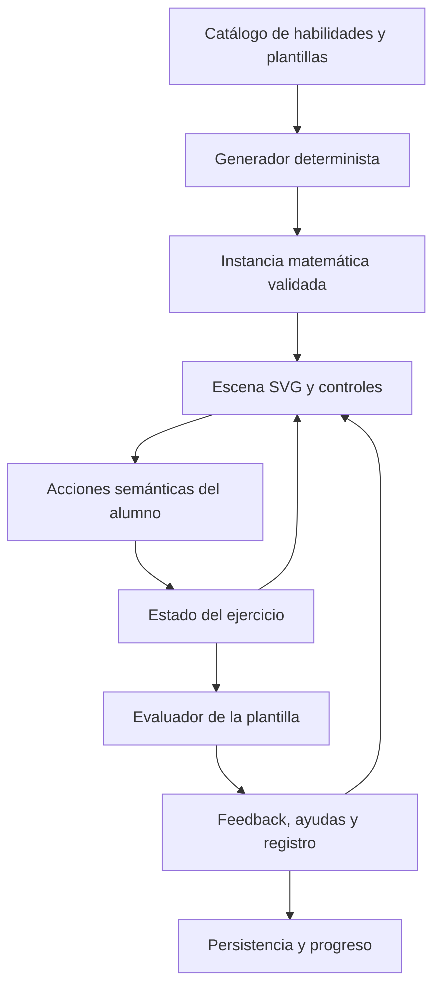
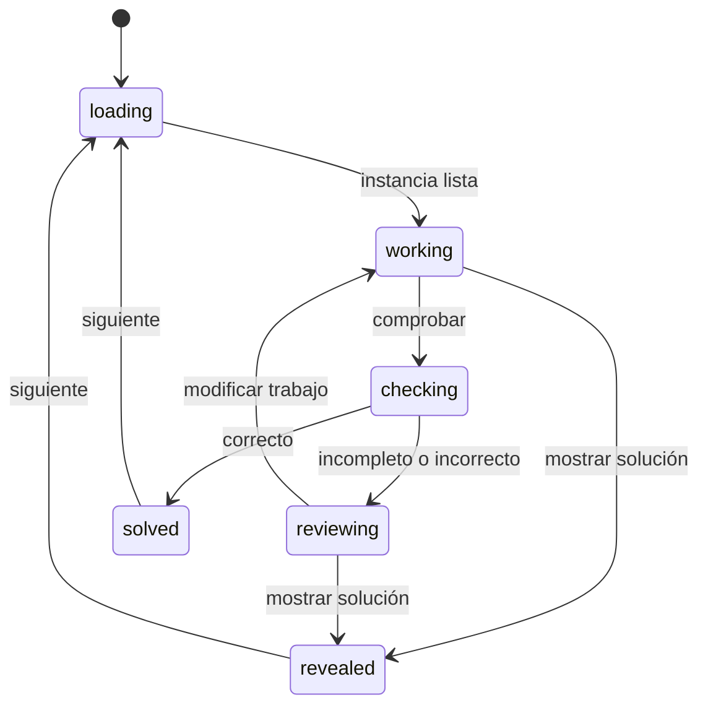

# KiteWise — Implementación de matemáticas visuales interactivas

**Versión:** 1.0 · 16 de octubre de 2026  
**Destinatario:** Claude Code y equipo de desarrollo  
**Alcance:** arquitectura, comportamiento y criterios de aceptación de las 12 representaciones visuales propuestas.

Este documento complementa `KiteWise_Prompt_Claude_Graficos.md` y la lámina `KiteWise_Referencias_Graficas.png`. Es una especificación de implementación, no una descripción de funciones ya integradas. No se ha inspeccionado el código de la app: React y TypeScript se usan como arquitectura de referencia, a confirmar al abrir el repositorio. Si el proyecto utiliza otra tecnología, conservar los contratos y adaptar las vistas.

## 1. Qué experiencia se quiere construir

El niño recibe un problema, representa una relación matemática y comprueba su trabajo. Una misma escena sirve para construir, resolver, comparar y explicar; no se limita a mostrar una imagen acompañada de respuestas.

**Ejemplo:** «Reparte 12 galletas por igual entre 3 platos».

1. Aparecen 12 galletas en la bandeja y 3 platos vacíos.
2. El niño mueve galletas o toca primero una galleta y luego su destino.
3. Cada plato muestra el conjunto que realmente recibió. El contador puede ocultarse según la habilidad.
4. El niño pulsa «Comprobar».
5. La app verifica que estén las 12 galletas, que todas se encuentren en platos y que cada plato tenga 4.
6. Si están desiguales, sugiere comparar los grupos sin redistribuirlos automáticamente.
7. Tras resolver, conecta la representación con `12 ÷ 3 = 4`.
8. El niño decide cuándo continuar. La siguiente instancia cambia los datos dentro de las reglas de la habilidad.

La manipulación, la comprobación matemática y la ayuda tienen responsabilidades separadas. Soltar una galleta en un plato es una acción válida aunque el reparto final todavía sea incorrecto.

## 2. Decisiones principales

| Decisión propuesta | Implementación | Motivo |
|---|---|---|
| Matemáticas determinadas por reglas | Generadores y evaluadores locales, puros y versionados | Reproducir ejercicios y verificar cantidades |
| Gráficos matemáticos vectoriales | SVG con geometría derivada de datos | Escala, nitidez y actualización de partes |
| Ilustraciones reutilizables | Objetos SVG y recursos aprobados; fondos ligeros | Coherencia visual sin generar imágenes por intento |
| Una vía común de acciones | Arrastrar, tocar y teclado producen la misma acción semántica | Evitar diferencias de comportamiento |
| Separar idioma e instancia | Traducir claves y parámetros sin regenerar números | Mantener el trabajo al cambiar ES/EN |
| Persistir acciones confirmadas | Guardar colocaciones, respuestas y ayudas | Recuperar sesiones sin guardar cada movimiento del puntero |
| Integración gradual | Tres familias iniciales; ampliar con el mismo contrato | Verificar el recorrido completo antes de extenderlo |

No hace falta añadir un servidor de IA ni una llamada a un modelo por cada ejercicio. Un relato generado opcionalmente debe conservar los datos validados de la instancia.

## 3. Arquitectura propuesta



**Dominio:** define cantidades, unidades, relaciones y soluciones válidas. No conoce posiciones del ratón ni componentes de interfaz.

**Interacción:** traduce gestos a acciones como `PLACE_TOKEN` o `TOGGLE_PART`. No decide si el alumno domina una habilidad.

**Presentación:** representa el estado, ofrece controles y muestra mensajes. No mantiene otra copia independiente de las cantidades.

**Aplicación:** selecciona ejercicios, conserva sesiones y conecta con autenticación y progreso existentes. Si no hay backend, puede funcionar localmente con persistencia del dispositivo.

En React, un reducer es una opción para centralizar transiciones; debe mantenerse puro. El generador, el guardado y los efectos de audio quedan fuera del reducer. Ver [R1]. Esta distribución es una propuesta para KiteWise, no un requisito de React.

## 4. Organización de módulos

Las rutas siguientes son orientativas; reutilizar convenciones del repositorio.

| Módulo sugerido | Responsabilidad |
|---|---|
| `math/domain/contracts.ts` | Tipos de instancia, estado, acciones y evaluación |
| `math/domain/registry.ts` | Registro de plantillas y versiones |
| `math/domain/random.ts` | Generador reproducible con semilla |
| `math/templates/<familia>/generate.ts` | Crear parámetros matemáticos válidos |
| `math/templates/<familia>/evaluate.ts` | Evaluar estado y producir códigos de feedback |
| `math/templates/<familia>/layout.ts` | Derivar posiciones y zonas desde el modelo |
| `math/templates/<familia>/Scene.tsx` | Dibujar la representación |
| `math/interaction/` | Selección, movimiento, teclado y cancelación |
| `math/session/` | Reducer, historial, envíos y recuperación |
| `math/ui/ExerciseShell.tsx` | Consigna, escena, ayudas y controles compartidos |
| `math/assets/` | Objetos y referencias aprobadas |
| `math/i18n/` | Consignas, mensajes, etiquetas y explicaciones |
| `math/persistence/` | Adaptador local y, si existe, remoto |
| `math/review/` | Galería interna de plantillas para revisión |

El registro asocia `templateId + templateVersion` con generador, inicializador, evaluador, renderer y catálogo de mensajes. Añadir una familia no debe requerir rehacer el contenedor de ejercicio.

## 5. Contratos de datos

Separar tres niveles:

- **Plantilla:** reglas reutilizables de una habilidad.
- **Instancia:** problema concreto e inmutable, con números y versión.
- **Intento:** trabajo modificable del niño sobre esa instancia.

Usar modelos específicos por familia. Evitar un objeto genérico que acepte propiedades incompatibles sin validarlas.

```ts
type Locale = 'es' | 'en';

type SharingModel = {
  kind: 'equal-sharing';
  tokenIds: string[];
  containerIds: string[];
  total: number;
  groups: number;
  answerPerGroup: number;
};

type FractionModel = {
  kind: 'fraction';
  numerator: number;
  denominator: number;
  wholeId: string;
};

// Ampliar la unión con modelos tipados de las otras familias.
type MathModel = SharingModel | FractionModel;

type ExerciseInstance = {
  schemaVersion: 1;
  instanceId: string;
  templateId: string;
  templateVersion: number;
  generatorVersion: number;
  skillId: string;
  seed: string;
  promptKey: string;
  model: MathModel;
};

type SharingWork = {
  // Cada token tiene exactamente una ubicación.
  placement: Record<string, string | null>;
  // null significa bandeja de origen, no desaparición del token.
};

type Evaluation = {
  outcome: 'correct' | 'incorrect' | 'incomplete' | 'invalid';
  feedbackKey: string;
  feedbackParams: Record<string, string | number>;
};
```

`schemaVersion` versiona el formato; `templateVersion`, las reglas didácticas; `generatorVersion`, el algoritmo que convierte semilla en parámetros. Guardar también el modelo generado para no depender de una futura regeneración idéntica.

El idioma se mantiene en la sesión o preferencias, fuera de la identidad matemática. Los valores derivados, como cuántos objetos hay en cada plato, se calculan desde `placement`; no se guardan como contadores independientes editables.

## 6. Generación de instancias

Secuencia de generación:

1. Elegir habilidad y plantilla habilitada.
2. Obtener una semilla estable para esa instancia.
3. Muestrear parámetros dentro del rango de la habilidad.
4. Derivar cantidades relacionadas desde una solución válida.
5. Validar invariantes y límites de representación.
6. Construir identificadores estables de objetos y recipientes.
7. Inicializar el trabajo del alumno.
8. Persistir la instancia antes de aceptar avances que deban recuperarse.

Para división exacta, elegir primero grupos y objetos por grupo y multiplicarlos. No elegir dos enteros arbitrarios y redondear el cociente.

```ts
type IntRng = { int(min: number, max: number): number };

function generateSharing(rng: IntRng): SharingModel {
  const groups = rng.int(2, 4);
  const answerPerGroup = rng.int(2, 5);
  const total = groups * answerPerGroup;

  return {
    kind: 'equal-sharing',
    groups,
    total,
    answerPerGroup,
    tokenIds: Array.from({ length: total }, (_, i) => `token-${i}`),
    containerIds: Array.from({ length: groups }, (_, i) => `plate-${i}`),
  };
}
```

El contrato del RNG es inclusivo en ambos extremos. Implementar y versionar un algoritmo determinista en el módulo de dominio. No llamar a `Math.random()` durante el render ni al cambiar idioma o tamaño de pantalla.

Si el generador no encuentra una instancia válida tras un límite configurado, usar una instancia de reserva revisada de la misma habilidad. Registrar el fallo técnico, sin presentarlo como error del niño.

## 7. Estado del ejercicio

Mantener separados el **estado de resolución** y el **gesto temporal**.

| Estado de resolución | Comportamiento |
|---|---|
| `loading` | Preparar o recuperar instancia |
| `working` | Permitir manipular, deshacer y pedir ayuda |
| `checking` | Congelar el envío mientras se evalúa una revisión concreta |
| `reviewing` | Mostrar feedback y conservar trabajo para corregir |
| `solved` | Mostrar explicación y ofrecer continuar |
| `revealed` | Mostrar solución solicitada; registrar que fue mostrada |
| `unavailable` | Ofrecer reintentar o volver conservando lo recuperable |

El gesto temporal puede estar `idle`, `selected` o `dragging`. No mezclarlo con «correcto» o «incorrecto». Pedir una pista es un evento; normalmente no cambia la fase de resolución.



Acciones compartidas propuestas:

| Acción | Datos | Efecto |
|---|---|---|
| `SELECT_OBJECT` | objeto | Cambiar selección |
| `PLACE_TOKEN` | objeto, destino o bandeja | Mover una identidad existente |
| `TOGGLE_PART` | parte | Cambiar selección de una fracción |
| `SET_VALUE` | campo, valor | Actualizar respuesta o magnitud |
| `UNDO` | ninguno | Restaurar último trabajo confirmado |
| `RESET_WORK` | ninguno | Reiniciar trabajo; conservar registro de ayuda e intentos |
| `REQUEST_HINT` | nivel | Mostrar ayuda y registrarla |
| `SUBMIT` | revisión | Evaluar una fotografía del trabajo |
| `CANCEL_GESTURE` | ninguno | Descartar movimiento temporal |

Tras modificar una respuesta ya evaluada, retirar el veredicto anterior. Un resultado tardío de otra revisión no debe marcar como correcto el trabajo nuevo.

## 8. Arrastrar, tocar y usar teclado

### 8.1 Acción común

Los tres métodos terminan en la misma orden: «coloca `token-4` en `plate-1`». El evaluador no recibe eventos de ratón.

**Tocar:** tocar objeto → indicar selección → tocar destino → confirmar colocación → anunciar cambio. Tocar otra vez el mismo objeto cancela la selección.

**Teclado:** ofrecer controles HTML para seleccionar objetos y destinos. Enter o Espacio activa; Escape cancela. Un panel equivalente puede contener «Seleccionar siguiente galleta» y botones «Colocar en plato 1/2/3». Debe permitir elegir también objetos ya colocados para moverlos o devolverlos.

**Arrastrar:** registrar el objeto al presionar; iniciar arrastre después de superar un umbral pequeño; mover una representación temporal; confirmar solamente al soltar sobre un destino válido. Un arrastre no debe disparar después el click de selección sobre el mismo objeto.

La alternativa por toques responde a WCAG 2.2, criterio 2.5.7, que contempla alternativas de puntero sin arrastre salvo sus excepciones. El soporte de teclado es un requisito adicional de la interfaz, no un sustituto de esa alternativa. Ver [R2].

### 8.2 Punteros y cancelación

Usar Pointer Events para compartir el tratamiento de ratón, tacto y lápiz. Capturar el puntero activo con `setPointerCapture(pointerId)` y manejar `pointerup`, `pointercancel` y pérdida de captura. Ignorar otros punteros mientras haya un gesto activo. Ver [R3].

En cancelación: retirar el objeto fantasma, mantener la ubicación confirmada anterior, limpiar captura y selección temporal. Si el objeto se suelta fuera de la escena, devolverlo visualmente al origen sin consumir intento matemático.

Durante un arrastre con captura, `event.target` puede seguir siendo el elemento capturador. Encontrar el destino por sus límites geométricos; no confiar en que `event.target` sea el plato sobre el que se soltó.

### 8.3 Coordenadas SVG

Las coordenadas del puntero están en pantalla; el modelo usa el sistema del SVG. Convertirlas antes de determinar un destino. La API `getScreenCTM()` proporciona la transformación y puede invertirse para esta conversión. Ver [R4].

```ts
function pointInSvg(
  svg: SVGSVGElement,
  clientX: number,
  clientY: number,
): DOMPoint | null {
  const matrix = svg.getScreenCTM();
  if (!matrix) return null;
  try {
    return new DOMPoint(clientX, clientY)
      .matrixTransform(matrix.inverse());
  } catch {
    return null;
  }
}
```

Si la escena tiene un grupo transformado, usar la transformación de ese grupo o llevar toda la geometría al sistema raíz antes del hit test. Mantener el desplazamiento entre punto de agarre y centro del objeto para que no salte al comenzar.

Recalcular al redimensionar. No guardar píxeles de pantalla como verdad persistente. Para objetivos pequeños, ampliar zonas efectivas sin hacerlas ambiguas ni superponer destinos.

### 8.4 Scroll y zoom

Limitar `touch-action: none` a las superficies que realmente necesiten arrastre libre; no aplicarlo a toda la página. Fuera de esas superficies, conservar desplazamiento y zoom. Determinar esta política antes de iniciar el gesto, como requiere el modelo de `touch-action`. Ver [R5].

En móvil, mantener siempre la alternativa por toque. No depender de que el niño arrastre mientras desplaza la página.

## 9. Ejemplo de evaluación: reparto exacto

El siguiente núcleo muestra validación matemática y estructural. Es un ejemplo para adaptar, no un módulo ya conectado al proyecto. Antes de usarlo, validar que el modelo tenga enteros positivos, identidades únicas, `total = tokenIds.length`, `groups = containerIds.length` y `total = groups × answerPerGroup`.

```ts
function evaluateSharing(
  model: SharingModel,
  work: SharingWork,
): Evaluation {
  const containers = new Set(model.containerIds);
  const keys = Object.keys(work.placement);
  const expected = new Set(model.tokenIds);
  const result = (
    outcome: Evaluation['outcome'],
    feedbackKey: string,
    feedbackParams: Evaluation['feedbackParams'] = {},
  ): Evaluation => ({ outcome, feedbackKey, feedbackParams });

  if (
    keys.length !== expected.size ||
    keys.some(id => !expected.has(id)) ||
    model.tokenIds.some(id => !Object.hasOwn(work.placement, id))
  ) {
    return result('invalid', 'sharing.invalidInventory');
  }

  const counts = new Map(model.containerIds.map(id => [id, 0]));
  let remaining = 0;

  for (const id of model.tokenIds) {
    const destination = work.placement[id];
    if (destination === null) {
      remaining += 1;
    } else if (!containers.has(destination)) {
      return result('invalid', 'sharing.invalidDestination');
    } else {
      counts.set(destination, counts.get(destination)! + 1);
    }
  }

  if (remaining > 0) {
    return result('incomplete', 'sharing.remaining', { remaining });
  }

  if ([...counts.values()].some(n => n !== model.answerPerGroup)) {
    return result('incorrect', 'sharing.compareGroups');
  }

  return result('correct', 'sharing.explanation', {
    total: model.total,
    groups: model.groups,
    perGroup: model.answerPerGroup,
  });
}
```

Ejemplos de aceptación para 12 objetos y 3 platos:

| Distribución | Bandeja | Evaluación |
|---|---:|---|
| 4, 4, 4 | 0 | Correcto |
| 5, 4, 3 | 0 | Incorrecto: comparar grupos |
| 3, 3, 3 | 3 | Incompleto: quedan objetos |
| 4, 4, 4 con identidad adicional | 0 | Estado inválido |
| Falta la entrada de un objeto | — | Estado inválido |
| Un objeto apunta a un plato inexistente | — | Estado inválido |

Un estado inválido requiere recuperación técnica; no descontar logro ni presentarlo como una equivocación matemática. No bloquear un quinto objeto en un plato: poder construir 5, 4, 3 permite detectar y discutir el reparto desigual.

## 10. Implementación de las 12 familias

| Familia y componente propuesto | Estado manipulable | Regla de evaluación | Ayuda o detalle importante |
|---|---|---|---|
| Bandejas · `TenFrameScene` | Celdas ocupadas; distinguir fichas iniciales y añadidas | Cantidad final objetivo; si se pregunta cuánto se añadió, validar también esa cantidad | Si empieza con 7, fijar esas fichas o especificar si pueden moverse |
| Base diez · `PlaceValueScene` | Piezas con valor 1, 10 o 100; intercambios | Suma de valores; exigir forma convencional solo si la consigna lo pide | Intercambio atómico: retirar 10 unidades y crear 1 decena sin alterar valor |
| Recta · `NumberLineScene` | Posición, saltos y dirección | Destino y, cuando sea objetivo, estrategia solicitada | Un salto de 3 puede llegar a 7; si se exigen 3 saltos de 1, también revisar pasos |
| Grupos · `EqualGroupsScene` | Objetos por grupo o celdas del arreglo | Número de grupos, tamaño y relación con el total | Distinguir construir 3 grupos de 4 de únicamente responder 12 |
| Reparto · `SharingScene` | Ubicación única de cada objeto | Inventario, destinos, igualdad y, si procede, sobrante | Separar repartir entre 3 grupos de formar grupos de 3 |
| Fracciones · `FractionScene` | Partes seleccionadas; partición y entero | Selección y valor racional, según consigna | Si se pide 3/4 del modelo en octavos, aceptar 6/8; si se pide partir en cuartos, verificar partición |
| Barras · `BarModelScene` | Segmentos asignados y valores | Relación parte–todo o comparación | En algunas tareas conviene dibujar longitud desconocida neutra para no regalar la solución midiendo |
| Medida · `MeasureScene` | Losetas, borde o capas | Área, perímetro o volumen con unidad | Mantener casillas cuadradas; diferenciar «cubrir», «rodear» y «llenar» |
| Reloj · `ClockScene` | Tiempo en minutos; duración separada | Hora o intervalo requerido | Derivar ambas agujas del mismo tiempo; no guardar ángulos independientes |
| Datos · `DataChartScene` | Frecuencias o respuestas | Valor, comparación o estadístico pedido | Escala y leyenda permanecen visibles; ofrecer tabla accesible equivalente |
| Plano · `CoordinateScene` | Coordenadas de puntos o recorrido | Par ordenado y, si se pide, secuencia | El eje y matemático crece hacia arriba; convertir al dibujar |
| Razones · `RatioScene` | Lotes y cantidades relacionadas | Razón equivalente y dato solicitado | Mantener cantidades positivas y unidades explícitas; no confundir razón con diferencia |

Los ejemplos de la lámina muestran estados ilustrativos, algunos resueltos. La pantalla del niño debe inicializarse según la tarea: platos vacíos si debe repartir; fracción vacía si debe colorear; reloj sin resolver si debe ajustarlo.

## 11. Reglas matemáticas y geometría

### Enteros, decimales y fracciones

- Para equivalencias racionales usar multiplicación cruzada: `a/b = c/d` si `a*d = c*b`, con denominadores positivos y límites de enteros seguros.
- Conservar denominador original cuando sea relevante a la tarea; no simplificar un modelo de 6/8 a cuatro piezas automáticamente.
- Para dinero, representar centavos enteros. Para otras cantidades decimales exactas, usar escala entera o racional adecuada al contenido.
- Validar unidades y magnitud por separado del formato de entrada. Aceptar formatos ES/EN según el parser definido, sin interpretar ambiguamente separadores.
- No usar igualdad flotante directa para comparar resultados geométricos derivados de píxeles.

### Reloj

Guardar minutos desde un origen definido. Para visualizar un reloj de 12 horas:

`minuteAngle = minuteOfHour * 6`  
`hourAngle = (hour % 12) * 30 + minuteOfHour * 0.5`

Ángulos medidos desde las doce, en sentido horario. A las 2:30 son 180° y 75°, respectivamente. El horario debe estar entre 2 y 3. Si se gira el minutero atravesando las doce, conservar el sentido y ajustar la hora; un ángulo aislado no basta. Para tiempo transcurrido, preservar día y a. m./p. m. cuando corresponda.

### Plano y recta

`screenX = left + (x - xMin) * stepX`  
`screenY = bottom - (y - yMin) * stepY`

Si hay que medir distancias o reconocer figuras sin distorsión, usar la misma escala física en ambos ejes. La tolerancia de toque sirve para seleccionar un punto cercano; la respuesta confirmada sigue siendo una coordenada exacta de la cuadrícula.

### Barras y áreas

La longitud de una barra conocida se deriva del valor y una escala común. Un cambio responsive debe modificar la escala completa, conservando proporciones. En fracciones, comparar modelos del mismo entero; en áreas, no estirar de forma desigual celdas que representan cuadrados unitarios.

## 12. Diseño responsive y accesibilidad

Una escena con `viewBox` puede escalar, pero reducirla indefinidamente vuelve pequeños los controles. Derivar el layout según espacio disponible: reubicar recipientes, dividir superficies y ofrecer selectores equivalentes antes de comprimir todos los elementos.

**Objetivo de producto:** controles frecuentes y destinos táctiles de aproximadamente 44 × 44 píxeles CSS o mayores. Esto es una decisión de comodidad para KiteWise. WCAG 2.2 AA 2.5.8 establece 24 × 24 píxeles CSS con excepciones; no debe describirse 44 px como el mínimo AA universal. Ver [R6].

Requisitos de implementación:

- Etiquetas accesibles de objetos y destinos: «Galleta 4, en plato 2».
- No asignar a toda una escena interactiva semántica de imagen que oculte sus controles. Si se usa un SVG como ilustración pasiva, dar título/resumen y controles equivalentes en HTML.
- Preferir botones HTML para acciones y alternativas. Si un control es SVG, implementar nombre, foco y teclado explícitamente y comprobarlo con tecnologías de asistencia.
- Señalar selección con forma o contorno además del color; comprobar contraste de textos y controles reales.
- Mantener foco tras mover objetos. Si desaparece un control, moverlo a un destino lógico.
- No anunciar cada píxel del arrastre. Comunicar colocación, ayuda y resultado con mensajes de estado; `role="status"` puede servir para actualizaciones no urgentes. Ver [R7].
- Controles «Escuchar», «Pista», «Deshacer», «Reiniciar» y «Comprobar» visibles según contexto.
- Animación breve como mejora visual, sin intervenir en la corrección. Respetar `prefers-reduced-motion`; mantener toda la información en estado estático. Ver [R8].
- Modo Enfoque elimina fondos ocupados, partículas y movimiento decorativo. No borra marcas o detalles necesarios para resolver.

## 13. ES/EN y lectura de consignas

Usar claves y parámetros tipados:

```json
{
  "sharing.prompt": {
    "es": "Reparte {total} galletas por igual entre {groups} platos.",
    "en": "Share {total} cookies equally among {groups} plates."
  },
  "sharing.compareGroups": {
    "es": "Compara los platos. ¿Todos tienen la misma cantidad?",
    "en": "Compare the plates. Does each have the same amount?"
  }
}
```

Adoptar el sistema de traducción existente y sus reglas de pluralización; el JSON anterior solo muestra el contenido. Traducir frases completas, no concatenar fragmentos. Las etiquetas SVG, nombres accesibles, feedback y explicación deben cambiar juntos.

Cambiar idioma conserva instancia, colocaciones, ayudas y número de intentos. Si hay lectura en voz alta, reproducir el texto del idioma seleccionado con el servicio existente; ofrecer detener y repetir. Si el audio falla, el ejercicio sigue funcionando.

No solicitar micrófono para manipular estas escenas. Si en el futuro se piden explicaciones orales, tratarlas como una función separada de los validadores deterministas.

## 14. Feedback y ayudas

El evaluador devuelve códigos y datos; la capa pedagógica selecciona el mensaje y el resaltado. No mezclar texto español dentro del algoritmo matemático.

Para reparto:

1. **Orientación:** resaltar los recipientes y preguntar si todos tienen lo mismo.
2. **Estrategia:** sugerir entregar uno a cada plato por turnos.
3. **Apoyo mayor:** mostrar un paso o ejemplo paralelo; si revela la solución concreta, marcarlo como solución mostrada.

Pedir ayuda no genera otra instancia ni cambia el inventario. Deshacer o reiniciar no elimina el historial de ayudas. Separar resultados independientes, con apoyo y tras solución mostrada.

Un error de gesto, como soltar fuera de un plato, no equivale a un intento matemático incorrecto. Pulsar «Comprobar» con respuesta incompleta puede registrarse como envío incompleto, separado de una solución conceptual incorrecta.

Para tareas abiertas, definir la familia de soluciones aceptables y evaluar sus invariantes. No rechazar una representación correcta porque sus objetos estén en otras posiciones.

## 15. Persistencia y conexión con el backend

### Estado local

Guardar instancia, trabajo confirmado, revisión, ayudas, historial mínimo e identificador de sesión. Usar el adaptador de persistencia que tenga la app; si no existe, definir uno sobre IndexedDB u otro almacén apropiado del cliente.

Guardar tras acciones confirmadas con agrupamiento razonable. No persistir posiciones temporales de arrastre. Al volver, validar esquema, versión y referencias antes de dibujar. Si no se puede migrar una sesión antigua, explicarlo y recuperar lo posible sin inventar resultados.

Deshacer restaura trabajo matemático; no borra evaluaciones ya enviadas. Un fallo de guardado debe quedar visible para la familia, sin afirmar que todo está sincronizado.

### API opcional propuesta

Estas rutas son un contrato de referencia, no endpoints existentes:

| Operación | Entrada principal | Respuesta |
|---|---|---|
| Obtener ejercicio | habilidad, cursor de sesión | Instancia y versión |
| Guardar borrador | instancia, revisión, trabajo | Revisión confirmada o conflicto |
| Enviar intento | `submissionId`, instancia, revisión, trabajo y ayudas | Evaluación y registro |
| Consultar progreso | estudiante autorizado, habilidad | Evidencia agregada y sesiones |

Si los resultados afectan informes o recompensas, el servidor debe cargar la instancia autorizada y evaluar el trabajo con sus reglas. No confiar en un `correct: true` enviado por el cliente. El modelo puede contener respuestas en el cliente para práctica; ocultarlas en el navegador no constituye una protección del resultado.

Usar `submissionId` único para evitar duplicados por reintentos de red. Mantener orden de revisiones y detectar conflictos entre dispositivos. No fusionar automáticamente dos repartos distintos. Guardar el borrador local antes de resolver un conflicto.

La práctica puede seguir sin conexión si la app ya proporciona los recursos e instancias necesarios. La sincronización offline requiere una cola persistente con reintentos; no se obtiene solo por usar SVG. Integrar con autenticación y separación de perfiles existentes.

## 16. Progreso y selección de dificultad

Registrar evidencia por habilidad: plantilla y versión, corrección, apoyos, solución mostrada y patrones de error. Contar colocaciones puede ayudar a estudiar usabilidad, pero un mayor número de movimientos no prueba menor comprensión.

Progresión sugerida, sujeta a revisión docente:

1. Objetos visibles y cantidades pequeñas.
2. Menos etiquetas auxiliares.
3. Representación parcialmente completada.
4. Dato desconocido en otra posición.
5. Relato diferente con la misma estructura.
6. Menor apoyo visual y transferencia a símbolos.

No declarar dominio por resolver tres ejemplos de una sola plantilla. Definir con docentes el conjunto de evidencias y pilotar el criterio. La duración puede servir para diagnóstico de experiencia, sin convertir velocidad de arrastre en medida de dominio.

## 17. Rendimiento y recursos gráficos

- Las cantidades viven en datos. Los recursos gráficos son representaciones de esas identidades, no otra base de datos.
- Usar identidades estables como claves de objetos; evitar identificadores basados en la posición actual.
- Durante el arrastre, actualizar el fantasma mediante un estado temporal o referencia; confirmar una acción de dominio al soltar. Agrupar actualizaciones visuales por fotograma cuando haga falta.
- Reutilizar componentes de semilla, plato, planta y bloques. Agrupar decenas o centenas cuando la representación lo permita, mostrando claramente el valor del grupo.
- No ocultar objetos silenciosamente para mejorar rendimiento ni usar un contador que contradiga la escena.
- Medir en un móvil representativo con las instancias más densas previstas. Definir límites de cantidad y tamaño por plantilla a partir de esa prueba.
- Evitar nuevas librerías grandes si SVG, controles nativos y herramientas existentes resuelven el problema.
- Reducir y reutilizar fondos. Cargar una decoración fallida no debe impedir resolver la actividad.

## 18. Eventos mínimos para analizar el uso

| Evento | Datos útiles | Qué permite observar |
|---|---|---|
| `exercise_started` | habilidad, plantilla, versión, sesión | Inicio real de práctica |
| `hint_requested` | instancia, nivel, revisión | Tipo de apoyo utilizado |
| `answer_submitted` | identificador único, revisión, resultado | Envíos y patrones de error |
| `exercise_resolved` | independiente, con ayuda o revelado | Condición de resolución |
| `exercise_left` | fase y trabajo guardado | Interrupciones sin atribuirles una causa |
| `interaction_issue` | código técnico, familia, dispositivo general | Fallos de gestos o representación |

No enviar cada coordenada del puntero como analítica habitual. No incluir nombres, audio o texto libre cuando estos eventos no los necesitan. Usar identificadores de perfil autorizados y la política de datos existente. Dejar los eventos desactivables en desarrollo y revisión.

## 19. Plan de comprobación

### Dominio

- Misma semilla y versión producen mismos parámetros.
- Todos los modelos cumplen sus invariantes.
- Repartos 4,4,4; 5,4,3; inventario incompleto y destino inexistente producen el resultado esperado.
- Intercambiar diez unidades no altera el valor total.
- Equivalencias de fracción y resultados decimales se evalúan con reglas exactas.
- El reloj a las 2:30 sitúa correctamente ambas agujas.
- Área y perímetro tienen unidades diferentes y valores correctos.

### Interacción

- Mover por arrastre y por toque produce el mismo estado.
- Cancelar, perder captura o soltar fuera no elimina ni duplica objetos.
- Un arrastre no activa luego un click adicional.
- Cambiar ancho u orientación no rompe destinos ni reposiciona datos matemáticos.
- Deshacer restaura la colocación, conservando el registro de ayudas.
- Cambiar idioma no genera otro ejercicio ni vacía el trabajo.

### Recorrido completo

- Resolver, equivocarse, pedir pista, corregir y continuar.
- Completar una actividad únicamente con teclado y otra mediante toques sin arrastre.
- Recuperar un borrador tras recargar.
- Enviar dos veces el mismo `submissionId` sin duplicar resultados.
- Simular pérdida de red y comprobar la cola, si se implementa sincronización.
- Verificar con lector de pantalla y movimiento reducido los mensajes y controles.
- Revisar capturas reales en móvil y escritorio para detectar texto cortado, cantidades ocultas y escalas erróneas.

Ejecutar las herramientas de pruebas existentes del proyecto. Las pruebas de generación y evaluación deben cubrir invariantes; las visuales, relaciones que podrían quedar incorrectas aunque el algoritmo dé la respuesta correcta.

## 20. Plan de entrega por fases

| Fase | Alcance | Condición para terminar |
|---|---|---|
| 0. Inspección | Repositorio, tema, idiomas, progreso y recursos | Decisiones de integración documentadas |
| 1. Núcleo y tres familias | Bandejas, grupos iguales y reparto; generador, estado y evaluación | Recorrido completo con interacción real y recuperación local |
| 2. Representaciones fundamentales | Base diez, recta, fracciones y barras | Reglas específicas, ayudas y pruebas de equivalencia |
| 3. Otras magnitudes | Medidas, reloj, datos, plano y razones | 12 familias revisables con ejemplos y variantes válidas |
| 4. Integración de progreso | Backend existente, sincronización e informes si aplica | Reintentos, autorización y persistencia comprobados |
| 5. Pilotaje | Observación con estudiantes y revisión docente | Ajustes de consignas, dificultad y accesibilidad |

No asignar estimaciones de calendario antes de inspeccionar el código y decidir cuántas variantes tendrá cada familia. «Familia implementada» requiere su acción manipulativa y evaluación, no solo una imagen de referencia.

## 21. Definición de terminado

Una plantilla se considera lista para revisión cuando:

- Se genera desde datos validados y conserva versión e identidad.
- Las cantidades, proporciones, unidades y soluciones coinciden con el dibujo.
- Su interacción principal funciona por toque y teclado; arrastre cuando aporta valor.
- Puede recuperarse de cancelaciones sin perder ni duplicar objetos.
- Tiene al menos una ayuda útil y explicación final correcta en ES/EN.
- Cambiar idioma o tamaño conserva el trabajo.
- Rechaza estados imposibles sin atribuirlos al aprendizaje del niño.
- Funciona con movimiento reducido y el Modo Enfoque.
- Sus comprobaciones de dominio y recorrido pasan.
- Tiene capturas reales, ejemplos revisados y limitaciones conocidas documentadas.

La publicación requiere además revisión curricular y pilotaje del contenido. Esta documentación no afirma que esas revisiones ya se hayan realizado.

## 22. Instrucción de ejecución para Claude

> Implementa esta especificación dentro del proyecto actual. Primero inspecciona sus patrones y documenta las decisiones que dependen del repositorio. Entrega la fase 1 funcionando de extremo a extremo antes de extender las demás representaciones. Conserva la identidad visual aprobada. Usa datos matemáticos como fuente única del dibujo y de la evaluación. No conviertas la actividad manipulativa en una pantalla de opción múltiple. Documenta lo implementado, lo comprobado y lo pendiente sin presentar ejemplos visuales como funciones terminadas.

## 23. Fuentes técnicas y alcance de las referencias

Consultadas el 16 de octubre de 2026. Las fuentes respaldan las APIs y los criterios indicados; la arquitectura, familias, contratos, fases y decisiones pedagógicas de este documento son propuestas para KiteWise.

- **[R1] React:** [Extracting State Logic into a Reducer](https://react.dev/learn/extracting-state-logic-into-a-reducer). Referencia para centralizar transiciones de estado.
- **[R2] W3C WAI:** [Understanding SC 2.5.7: Dragging Movements](https://www.w3.org/WAI/WCAG22/Understanding/dragging-movements.html). Alternativa de puntero sin arrastre.
- **[R3] MDN:** [Pointer events](https://developer.mozilla.org/en-US/docs/Web/API/Pointer_events). Entrada unificada, captura y cancelación de punteros.
- **[R4] MDN:** [SVGGraphicsElement.getScreenCTM()](https://developer.mozilla.org/en-US/docs/Web/API/SVGGraphicsElement/getScreenCTM). Conversión entre coordenadas del SVG y pantalla.
- **[R5] MDN:** [touch-action](https://developer.mozilla.org/en-US/docs/Web/CSS/Reference/Properties/touch-action). Coordinación de gestos con el navegador.
- **[R6] W3C WAI:** [Understanding SC 2.5.8: Target Size (Minimum)](https://www.w3.org/WAI/WCAG22/Understanding/target-size-minimum.html). Tamaño mínimo y excepciones.
- **[R7] W3C WAI:** [Understanding SC 4.1.3: Status Messages](https://www.w3.org/WAI/WCAG22/Understanding/status-messages.html). Comunicación de cambios de estado a tecnologías de asistencia.
- **[R8] MDN:** [prefers-reduced-motion](https://developer.mozilla.org/en-US/docs/Web/CSS/Reference/At-rules/@media/prefers-reduced-motion). Adaptación a preferencias de movimiento.

### Comprobación de los ejemplos de esta documentación

Se comprobó la sintaxis ejecutable de los cuatro bloques TypeScript tras retirar sus anotaciones de tipos con Node, se ejecutaron seis casos del evaluador de reparto y se validó el JSON de traducciones. No se realizó comprobación estática con el compilador de TypeScript ni integración con el repositorio de KiteWise. Los casos ejecutados fueron reparto correcto, reparto desigual, inventario sin terminar, objeto adicional, objeto ausente y destino inexistente.
