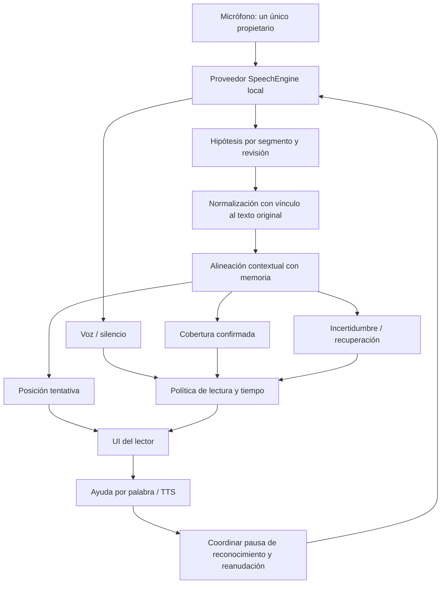

# Cómo hacer que Kitewise lea con el niño

Investigación técnica y de producto · 22 de octubre de 2026 · Estado: recomendación para prototipos, no activación del micrófono.

## 1. Conclusión y decisión recomendada

La experiencia que Victor describe al usar el micrófono de Gboard es una buena referencia de interacción: el niño habla y la aplicación responde mientras habla, sin esperar a que termine toda una página. Podemos construir una experiencia de ese tipo. No basta, sin embargo, con poner un dictado dentro del lector: necesitamos reconocimiento de voz, seguimiento del texto conocido y una política pedagógica que decida cuándo acompañar y cuándo esperar.

Mi recomendación es **comparar reconocimiento local de Android y un modelo local de streaming con el Whisper que ya tenemos**, usando el mismo comparador de lectura corregido. El primer prototipo debe responder: ¿qué alternativa sigue mejor una lectura infantil real en ES/EN, con pocas interrupciones y sin enviar voz fuera del teléfono? No elegiría un proveedor definitivo solo por una demostración de dictado adulto.

La secuencia concreta es:

1. Corregir y probar el alineador antes de conectarlo a cualquier micrófono: hoy el motor experimental puede dar por leídas palabras que no confirmó.
2. Probar Android `SpeechRecognizer` en modo estrictamente local en el Fold, con resultados parciales y sesiones segmentadas cuando estén disponibles. `expo-speech-recognition` tiene versión 57.0.0, pero necesita controles adicionales de compatibilidad y privacidad.
3. Comparar contra Moonshine Tiny Streaming en inglés y español. Su catálogo actual declara ambos idiomas y licencia MIT para esos modelos; falta medirlos con niños y validar su integración nativa en nuestra app.
4. Mantener Whisper Tiny/Base como referencia local ya disponible; no activar a ciegas la ruta `RealtimeTranscriber` de `whisper.rn@0.7.4`, porque hay defectos documentados de esa ruta y correcciones posteriores que no se pueden suponer incluidas en el paquete estable.
5. Elegir por mediciones en dispositivo: posición de lectura, falsos avances, retraso, comportamiento con pausas, estabilidad y comodidad. Conservar siempre lectura manual y ayuda por palabra.

Android es el candidato de menor fricción para una primera prueba parecida al teclado. Moonshine es el candidato independiente más interesante que encontré para comparar streaming local EN/ES. Sherpa-ONNX queda como alternativa técnica seria, condicionada a elegir un modelo concreto adecuado; Vosk, Picovoice y APIs comerciales aportan opciones y referencias, con limitaciones distintas. No hay resultados en el Fold ni evidencia suficiente para declarar un ganador de precisión infantil. [S01] [S06] [S07] [S09] [S12] [S13] [S22] [S27] [F06] [F08]

La regla D1 del proyecto sigue vigente: **la voz del niño no se guarda ni sale del dispositivo**. Investigar APIs de nube permite comparar capacidades; no autoriza a enviarles audio. Esta investigación no cambia esa decisión, las dependencias de la app ni el APK 0.1.2.

## 2. Alcance, método y límites de la investigación

Se revisaron el código actual del proyecto, contratos, documentación y resultados previos; código fuente de Android/AOSP; documentación y código de bibliotecas; muestras oficiales de proveedores; trabajos y repositorios de investigación infantil; fichas de modelos; licencias y conversaciones técnicas de mantenedores.

La documentación web de Android, Google Cloud, Microsoft Learn, Gboard, arXiv y algunos sitios comerciales devolvió 403 desde este entorno. Para los temas principales se consultaron fuentes originales publicadas en GitHub: los JavaDocs del propio AOSP, muestras oficiales de Google/Microsoft y SDKs oficiales. No se presenta una página bloqueada como una página leída. Para determinados artículos se pudo leer el resumen indexado en Hugging Face y el repositorio de sus autores, no el PDF completo. Las limitaciones particulares están registradas en [FUENTES.md](FUENTES.md).

Se verificó además el paquete publicado `expo-speech-recognition@57.0.0`: descarga del tarball, comprobación de su integridad SHA-512 contra el registro npm e inspección de los fuentes incluidos, sin instalarlo ni ejecutar su código. El commit declarado por ese paquete es `996258b7473ee723e9ffb5bb73d8694f091254ba`; sus archivos relevantes también se consultaron mediante URLs fijadas a ese commit. Esto permite distinguir el código de una versión utilizable de lo que aparece actualmente en `main`. [S07] [S08] [S09] [S10] [S11]

Las categorías de evidencia usadas son:

| Categoría | Qué permite afirmar | Qué no demuestra |
|---|---|---|
| API/código oficial | Que existen una función, opción o comportamiento en el código consultado | Que todos los proveedores o dispositivos lo implementen igual |
| Código publicado y versionado | Cómo actúa esa versión del wrapper | Que la integración completa funcione con nuestra app |
| Investigación con corpus | Resultados bajo su población, datos, protocolo y hardware | Calidad con Noah, español infantil o Fold, si no se evaluaron |
| Reporte de desarrollador | Una reproducción o problema concreto que merece una prueba | Frecuencia del problema en todos los usuarios |
| Documentación comercial | Capacidades y condiciones declaradas por el proveedor | Ventaja independiente en lectura infantil |
| Inspección de Kitewise | Qué hace nuestra implementación actual | Rendimiento acústico en un teléfono no medido |

No se grabó voz infantil, no se descargaron corpus con grabaciones de niños y no se enviaron audios a ningún proveedor. Las pequeñas reproducciones del comparador utilizaron solo frases escritas.

## 3. Qué necesitamos reconocer realmente

Hay al menos cinco problemas distintos que suelen confundirse:

| Problema | Ejemplo | Tecnología apropiada |
|---|---|---|
| Detección de voz | «Hay alguien hablando» | VAD |
| Reconocimiento de palabras | «Oí “la puerta azul”» | ASR/STT |
| Seguimiento de lectura | «Está en la tercera palabra de esta oración» | Alineación contra el cuento |
| Evaluación de pronunciación | «La realización de este fonema necesita práctica» | Modelo acústico/fonético y evaluación validada |
| Identificación de hablante | «Esta voz pertenece a una persona concreta» | Verificación/identificación de hablante |

Para la primera versión de acompañamiento necesitamos las tres primeras. La pronunciación que la app reproduce al tocar una palabra es **TTS**, una salida de audio; no es un evaluador de cómo pronunció el niño. Puede mantenerse y funcionar bien mientras desarrollamos la entrada de voz.

No necesitamos identificar biométricamente a Noah para seguir el cuento del perfil elegido. Tampoco el VAD puede distinguir por sí solo a un niño de un adulto, o al niño de un televisor. La diarización separa intervenciones de hablantes; no garantiza quién es cada uno ni resuelve automáticamente esa atribución. Introducirla ahora aumentaría complejidad sin resolver el problema principal.

Un dictado general intenta producir un texto legible. Puede normalizar «veintiuno» como `21`, omitir repeticiones o favorecer una palabra gramaticalmente probable. Eso es útil al escribir mensajes, pero puede esconder precisamente la vacilación que un tutor necesita interpretar con cuidado. El texto transcrito y la evidencia acústica no son equivalentes.

## 4. Lo que Gboard nos enseña y lo que no podemos asumir

La referencia valiosa de Gboard es su respuesta progresiva, la activación clara del micrófono y la facilidad para detenerlo. No hemos identificado un contrato público para incrustar en una app el mismo módulo interno de dictado de Gboard y obtener todas sus capacidades. El teclado y un SDK de voz son productos distintos.

La vía pública cercana es `android.speech.SpeechRecognizer`. Permite escuchar resultados mediante `RecognitionListener`, incluidos resultados parciales cuando el proveedor los entrega. También existe una fábrica explícita para un reconocedor local. Eso hace razonable intentar una experiencia similar, pero no permite prometer que el mismo teléfono entregue exactamente la misma calidad y latencia que Gboard. [S01] [S03]

Hay diferencias que dependen del servicio instalado, idioma, modelos descargados, versión Android y ruta usada por el teclado. No debemos atribuir a todos los Samsung capacidades publicitadas para Pixel, ni inferir disponibilidad local solo porque el Fold tenga buen procesador.

Tampoco recomendaría el atajo de mostrar un campo de texto oculto y depender del micrófono del teclado. Ese camino deja en manos del IME el inicio, la edición y la entrega del texto; dificulta conservar tiempos, hipótesis parciales, estados de micrófono y permisos. El lector necesita gobernar esos eventos mediante su propia abstracción de voz.

La prueba correcta es consultar el servicio y los idiomas del Fold, comprobar el modo local, descargar previamente modelos si corresponde y observar resultados parciales en una aplicación de diagnóstico nativa. La disponibilidad del inglés no implica disponibilidad del español ni de todos sus locales.

## 5. Android SpeechRecognizer: capacidades, límites y privacidad

### 5.1. Las APIs relevantes

Las APIs de reconocimiento local se incorporaron en Android 12/API 31. La consulta de compatibilidad y descarga de modelos se amplió en Android 13/API 33; información de palabra y otras opciones se amplió en versiones posteriores. Los niveles 31/33/34 se contrastaron además con los atributos `since` del SDK Android 36 oficial instalado; el extracto está en [ANDROID-API-LEVELS.json](ANDROID-API-LEVELS.json). Hay que comprobar nivel de API y soporte del proveedor, no solo la presencia de un nombre en una biblioteca compilada con un SDK reciente. [S01] [S02] [S03] [S04] [S05]

| Elemento | Para qué sirve en Kitewise | Precaución |
|---|---|---|
| `isRecognitionAvailable` | Saber si hay un servicio de reconocimiento | No confirma reconocimiento local ni idioma |
| `isOnDeviceRecognitionAvailable` | Saber si hay un servicio local | No confirma modelo instalado para cada locale |
| `createOnDeviceSpeechRecognizer` | Elegir explícitamente la ruta local | Puede no estar disponible; debe fallar sin cambiar a red |
| `checkRecognitionSupport` | Consultar soporte de una solicitud y sus idiomas | Depende de versión/proveedor; hay que manejar errores |
| `triggerModelDownload` | Preparar el modelo antes de leer | Descarga no equivale a estar listo inmediatamente |
| `onPartialResults` | Respuesta antes de cerrar una frase | Puede corregirse, llegar irregularmente o no llegar |
| `onResults` | Resultado final de una solicitud | No sustituye a un protocolo de sesión continua |
| `onSegmentResults` | Finales por segmentos en una sesión segmentada | Solo si la implementación soporta ese modo |
| `EXTRA_AUDIO_SOURCE` | Proveer un flujo PCM mediante descriptor | No significa «grabar un WAV»; gestionar cierre del flujo |
| Timing/confianza por palabra | Ayudar a localizar y medir palabras | Son opcionales y no una nota de pronunciación |

Los JavaDocs advierten que el reconocedor genérico puede enviar audio a servidores y que esa API no está pensada como reconocimiento continuo indiscriminado por su consumo de batería y ancho de banda. La existencia posterior de sesiones segmentadas permite diseñar otra estrategia cuando el proveedor la soporta; no convierte cualquier combinación de dispositivo/servicio en un streaming ilimitado y garantizado. [S01] [S02]

### 5.2. `PREFER_OFFLINE` no basta

`EXTRA_PREFER_OFFLINE` se describe como opción de reconocimiento sin red, pero el mismo contrato advierte que su efecto depende de la implementación. Para D1 no basta con enviar esa preferencia a un reconocedor genérico y suponer privacidad. Debemos seleccionar la fábrica local y rechazar el inicio si no está disponible. [S02]

Además, quitar `INTERNET` de nuestra app **no demuestra** que un servicio de reconocimiento invocado por IPC no pueda usar su propio acceso a red. Ese servicio corre bajo otra identidad del sistema. La restricción del manifiesto de Kitewise es útil, pero no reemplaza escoger correctamente el servicio local.

La validación debe combinar inspección del camino de creación, consultas de capacidades, prueba sin conectividad después de preparar modelos y comprobación del comportamiento conectado. Una prueba en modo avión demuestra que una operación pudo funcionar sin conexión; por sí sola no demuestra que jamás se envíe audio cuando la conexión está disponible.

### 5.3. Pausas y sesiones largas

Un niño puede tardar varios segundos entre palabras. El fin acústico de un segmento no debería ser el fin de la lectura, ni cerrar el cuento, ni disparar una corrección. Hay que tratar una sesión de lectura como una entidad superior a las sesiones internas del proveedor.

Pedir tiempos de silencio enormes no garantiza que el servicio obedezca. Tampoco es buena idea reiniciar el reconocedor en un bucle rápido ante cualquier error: produce huecos, beeps, conflictos de micrófono y posiblemente límites de solicitudes. Un reinicio controlado necesita espera acotada, un máximo de intentos, identificación de sesión y una salida manual comprensible.

### 5.4. Qué medir en el Fold

Necesitamos registrar como metadatos del ensayo: versión Android/One UI, servicio local y su versión, locales solicitados y realmente disponibles, modelos instalados, resultados parciales/finales, segmentos, errores y reinicios. La ficha comercial «Fold 7» no alcanza para describir el entorno.

Debe probarse cerrado, abierto, girado, con otra app usando el micrófono, al bloquear pantalla y al regresar. Las variaciones de micrófono o ruta de audio pueden cambiar la calidad incluso sin cambiar de modelo.

## 6. Integración con Expo: biblioteca concreta y auditoría de versión

### 6.1. Candidata principal para el primer ensayo

`expo-speech-recognition` conecta APIs nativas de Android, iOS y web. Su documentación identifica una rama 57.0.0 para Expo SDK 57; el paquete existe en npm y se inspeccionó su código publicado. Esto la convierte en una candidata mucho más adecuada que seguir una guía antigua de `@react-native-voice/voice`, cuyo propio repositorio se declara archivado/deprecado y recomienda aquella alternativa. [S06] [S07] [S08] [S09] [S10] [S11] [S63]

La compatibilidad anunciada es una razón para ensayar, no una prueba de integración terminada con RN 0.86.3, Hermes y nuestro APK release. Deben verificarse prebuild, autolinking, R8, permisos, consultas de servicios y arquitectura nativa. Hay un PR real relacionado con minificación que justifica probar el APK release y no limitarse a Expo web o un build de desarrollo. [F10]

### 6.2. Hallazgos de la versión 57.0.0

**Android:** el código utiliza `createOnDeviceSpeechRecognizer` cuando se solicita reconocimiento local y la versión es API 33 o superior. En versiones anteriores entra en otras ramas y agrega la preferencia offline. Nuestra app permite Android desde API 24: instalar esta biblioteca no convierte esa preferencia en una garantía local en todos nuestros teléfonos admitidos. [S09]

Por eso, con ese wrapper concreto, propondría inicialmente habilitar su proveedor estricto solo desde API 33, después de comprobar servicio e idioma. Para Android 12/API 31–32 se puede valorar un módulo nativo propio que use la fábrica local, o mantener otro motor local; no permitir una caída silenciosa al reconocedor genérico. Por debajo, un modelo propio compatible o lectura manual.

**iOS:** en la versión inspeccionada, `requiresOnDeviceRecognition` se configura únicamente cuando el reconocedor dice soportar el modo local. Si no lo soporta, esa rama no fuerza por sí sola un error. Un issue público y la respuesta de un mantenedor reconocen el problema de la degradación silenciosa. Esto requiere una barrera explícita de disponibilidad si posteriormente se habilita iOS. No es un problema que deba trasladarse al niño ni un motivo para aceptar red por defecto. [S11] [F04]

**Archivos:** en Android, el camino continuo crea un grabador que usa un pipe de audio. Con `persist: false`, el código inspeccionado condiciona la escritura de muestras PCM a una ruta de salida no nula, por lo que esa rama no escribe esas muestras al archivo. Sí crea y abre un archivo temporal vacío. No sería correcto afirmar que `persist: false` guarda la voz; tampoco que no crea ningún archivo. Hay que comprobar cierre y limpieza, y evitar copiar ejemplos con `persist: true`. [S10]

**Logs:** el servicio inspeccionado incluye mensajes de diagnóstico que contienen hipótesis de reconocimiento. Un adaptador que no guarde audio no elimina por sí mismo logs internos del wrapper. La integración debe impedir que el texto infantil aparezca en registros de producción o capturas de diagnóstico persistentes. [S09]

### 6.3. Eventos y detención

El issue #165 describe pérdida del resultado final al llamar a `stop()` inmediatamente después de hablar, con parciales ya recibidos. El #158 reproduce una carrera similar en reconocimiento local continuo. El PR #163 que propone corregirlo seguía abierto y sin fusionar al consultar esta investigación. No se debe dar el problema por solucionado solo porque exista ese PR. [F01] [F02] [F05]

El issue #87 describe que las hipótesis después de una pausa sustituyen texto anterior; eso refuerza la necesidad de interpretar resultados por segmento y revisión, no concatenar cada parcial. Parte de este comportamiento es semántica normal de un reconocedor: la app debe saber qué se reemplaza y qué se confirma. [F03]

Para detener una sesión, el producto debe distinguir: finalizar lectura, pedir una ayuda TTS, cambiar página, pasar a segundo plano y cancelar por error. No todas esas acciones requieren «cerrar, perder el resultado y reiniciar» de la misma manera.

## 7. Otra ruta de Google: ML Kit GenAI Speech

Hay una muestra oficial nueva bajo `googlesamples/mlkit/android/speech`. Expone `SpeechRecognition.getClient`, respuestas parciales/finales, modos Basic/Advanced, consulta de disponibilidad y estados de descarga. La muestra consultada depende de `com.google.mlkit:genai-speech-recognition:1.0.0-alpha1`. Su selector incluye `en-US`, `es-US` y `es-ES`, entre otros. [S32] [S33] [S34] [S35]

Eso merece una investigación de laboratorio específica: podría ser una vía moderna alternativa a `android.speech.SpeechRecognizer`. No significa que esté lista para producción ni que el selector pruebe disponibilidad real de cada locale en el Fold. El propio ejemplo exige consultar estados como disponible, descargable o no disponible.

La documentación completa de esa API no fue accesible desde el entorno. Por ello quedan sin confirmar aquí su matriz completa de dispositivos, garantías contractuales de procesamiento, cuotas, estabilidad, descarga y comportamiento offline por modo/idioma. El código de muestra no reemplaza ese contrato. No recomendaría adoptarla como motor principal apoyándonos únicamente en el ejemplo alfa.

También encontramos una precaución concreta de copia de código: la ruta del ejemplo que usa descriptor crea un archivo PCM temporal y escribe muestras. La alternativa `AudioSource.fromMic()` no sigue esa misma ruta de la aplicación. Para Kitewise no se copiaría la rama con archivo de audio, aunque se llamara «temporal». [S33]

## 8. Whisper: conservar lo útil y reconocer sus límites

Whisper permite ejecutar modelos multilingües locales con una base de software amplia. El proyecto ya tiene empaquetados Tiny y Base cuantizados y Silero VAD; esto reduce el trabajo de preparar una referencia reproducible, y mantiene la posibilidad de funcionar sin servicios Google. [S12] [S13] [S14] [S15]

La implementación actual de Kitewise corta frases mediante VAD y luego llama a `transcribeData`. Eso ofrece transcripción por fragmentos. Que exista un callback llamado `onPartialResult` en nuestra interfaz no significa que el proveedor actual lo emita: la implementación nativa inspeccionada solo publica resultados finales.

Whisper no es un modelo causal de streaming palabra a palabra por diseño original. Sí se puede construir transcripción progresiva encima, con ventanas superpuestas, nuevas decodificaciones y criterios de estabilidad. WhisperStreaming y SimulStreaming muestran técnicas para hacerlo. El trabajo WhisperStreaming declara 3,3 segundos de latencia en su escenario publicado; eso no es un resultado de nuestra tablet ni un objetivo suficiente para resaltar cada palabra infantil de manera inmediata. [S15] [S16] [S17]

### 8.1. Por qué no basta con usar un modelo más grande

Un modelo mayor puede mejorar ciertos errores y empeorar latencia, memoria, batería y temperatura. Si reconoce muy bien una frase después de varios segundos, puede servir como confirmador pero sentirse mal como cursor de lectura en vivo. Lo que necesitamos no es solo WER bajo, sino llegar a tiempo y no adelantar al niño.

Los modelos `.en` son ingleses. Una mejora de Tiny.en adaptado a niños no resuelve el español. Los pesos Tiny/Base multilingües actuales evitan esa exclusión, pero no garantizan igual calidad en ambos idiomas.

Whisper puede inventar texto ante silencio, ruido o entradas fuera de distribución. Su ficha oficial lo reconoce. El VAD reduce algunas entradas problemáticas; no convierte cada transcripción aceptada en evidencia incuestionable de lectura. [S15] [S18]

### 8.2. El estado real de whisper.rn

Al consultar npm, la versión estable indicada es 0.7.4, la misma serie que usa la app. En el repositorio upstream hay correcciones posteriores relevantes:

- #338 corrige un tamaño de pre-roll de VAD calculado con unidades incorrectas; aparece fusionado el 29 de septiembre de 2026.
- #339 describe crecimiento de memoria y colas en `RealtimeTranscriber`, con reproducción en 0.7.4 y referencias a RN 0.86.3/Expo 57.
- #340 limita trabajo/memoria y figura fusionado el 6 de octubre de 2026.
- #330 describe una ruta sin VAD que no emite el callback estabilizado esperado. [F06–F09]

Nuestra implementación actual no usa esa clase `RealtimeTranscriber`: usa su propio segmentador y `transcribeData`. No se puede adjudicarle automáticamente el mismo fallo de aquella ruta. Pero sí es una razón concreta para no sustituirla por el ejemplo realtime de 0.7.4 sin comprobar qué correcciones contiene la versión realmente instalada.

Tampoco daría por hecho que el NPU del Fold acelera nuestro modelo. Hay trabajos experimentales del backend Hexagon en upstream; su compatibilidad depende de versión, cuantización y compilación. El código actual carga Whisper con `useGpu: false`, y el modelo Base del proyecto es Q5_1. No basta con encender una opción genérica y prometer rendimiento de otro teléfono.

### 8.3. Papel recomendado

Whisper sigue siendo valioso como referencia local y candidato de respaldo, o como confirmador de fragmentos si las mediciones lo justifican. Ejecutar dos modelos simultáneamente no debe ser el primer diseño: aumenta energía, complejidad y conflictos de captura. Primero comparar proveedores por separado con un único propietario del micrófono.

## 9. Moonshine, Sherpa-ONNX, Vosk y otras alternativas locales

### 9.1. Moonshine: candidato real de streaming EN/ES

El catálogo consultado de Moonshine declara modelos Tiny Streaming y Small Streaming tanto para inglés como para español. Tiny Streaming tiene 34 millones de parámetros; Small Streaming, 123 millones. La licencia actual distingue los modelos streaming MIT de algunos modelos antiguos no streaming y no ingleses que conservan licencia Community. Elegir el modelo español antiguo por accidente cambiaría las condiciones de distribución. [S26] [S27] [S28] [S29] [S30] [S31]

Esto es importante porque muchas recomendaciones de «Moonshine solo inglés» se refieren a versiones anteriores. La investigación debe fechar el catálogo y elegir un artefacto concreto. A la vez, los WER publicados por el proyecto para español provienen de paneles generales, no de lectura infantil del Fold. No permiten decir «será más preciso con Noah».

Hay binding y ejemplo Android oficiales, de modo que no dependemos necesariamente de portar una biblioteca Python al móvil. Pero el binding inspeccionado declara `minSdk = 26` y tres ABIs (`arm64-v8a`, `armeabi-v7a`, `x86_64`); Kitewise actualmente declara minSdk 24 y entrega cuatro ABIs, incluido x86. Es un trabajo de compatibilidad real: no basta con cargar el modelo y prometer que toda nuestra cobertura Android permanece igual. [S30] [S64]

El primer ensayo puede vivir en una aplicación de diagnóstico separada para el Fold. Antes de una integración productiva habría que resolver módulo Expo/RN, manifiestos, bibliotecas nativas, tamaño, memoria, licencia de los pesos exactos y nuestra matriz de dispositivos. Que un motor sea local y abierto no elimina ese costo de ingeniería.

Su interés para Kitewise es: independencia de servicios Google, modelos streaming de tamaño relativamente contenido y disponibilidad documentada EN/ES. Su incertidumbre principal es la lectura infantil, junto con compatibilidad e instrumentación nativa. Es un **candidato para medir**, no una sustitución ya validada.

### 9.2. Sherpa-ONNX: un runtime amplio, no un único reconocedor

Sherpa-ONNX permite ejecutar familias distintas de modelos de voz y ofrece ejemplos Android/Java/C++, además de bindings de la comunidad para React Native. El wrapper RN consultado anuncia reconocimiento streaming mediante familias como transducer, paraformer y CTC compatibles. [S22] [S23] [S24] [S25]

La pregunta correcta no es «¿Sherpa reconoce español?», sino «¿qué modelo exacto de español, con qué licencia, tamaño, frontend, streaming y tokenización, corre en la versión de Sherpa que vamos a distribuir?». Que el runtime cargue Whisper o Moonshine offline no convierte ese modelo en streaming en esa integración.

Es atractivo si necesitamos más control del flujo acústico o probar varios modelos dentro de una capa nativa. Requiere verificar la madurez del binding RN, su soporte de nuestra versión y la distribución de cada peso. No encontré en lo revisado un benchmark infantil ES/EN en Fold que permita recomendar un modelo Sherpa específico por encima de los demás.

Lo mantendría como alternativa técnica y vehículo de experimentación. No añadiría diarización, separación de fuentes y TTS simplemente porque el runtime los ofrezca: el alcance inicial es seguir una voz leyendo.

### 9.3. Vosk: streaming ligero y control de vocabulario

Vosk tiene API de streaming y muestras Android; puede exponer resultados parciales, finales y palabras. Su código utiliza licencia Apache-2.0. Los modelos tienen condiciones y características propias que deben comprobarse por separado. [S19] [S20] [S21]

Puede ser una base útil para un prototipo pequeño y para estudiar gramáticas o vocabularios restringidos. El riesgo pedagógico es restringir tanto el decodificador al cuento que termine produciendo una palabra esperada aunque la evidencia sea débil. Un vocabulario orientador debe permitir detectar que el niño dijo otra cosa, se detuvo o se corrigió.

La página oficial de modelos estuvo bloqueada y no se verificó aquí un artefacto español concreto con tamaño, licencia y precisión infantil. No presento cifras de megabytes copiadas de tutoriales antiguos como si fueran vigentes. Lo clasificaría como referencia local y opción de equipos modestos, sujeta a prueba comparativa.

### 9.4. Picovoice Cheetah y Leopard

Cheetah se presenta como STT streaming local y su documentación incluye inglés y español. Leopard es una alternativa de transcripción local por bloques/archivo. El SDK requiere un AccessKey y condiciones comerciales del proveedor, por lo que «ejecución local» no significa «sin condiciones comerciales» ni «todos los modelos tienen licencia abierta». [S36] [S37]

Cheetah merece una comparación si queremos reducir trabajo de ingeniería con un producto local mantenido. Antes se verificarían licencia de distribución, validación de clave, funcionamiento sin conexión tras la preparación, paquetes de idioma y dependencias de red del SDK. Esta investigación no ha validado esos contratos ni su precisión infantil.

### 9.5. NeMo, SpeechBrain, Parakeet y modelos de investigación

NeMo y SpeechBrain son herramientas valiosas para entrenamiento, evaluación y experimentación; no constituyen por sí solas un motor Android listo para el lector. Un checkpoint grande de servidor puede ser una excelente referencia científica y una mala elección para un teléfono. [S60] [S61]

La ficha consultada de `parakeet-tdt-0.6b-v2` corresponde a una variante inglesa; no se debe extrapolar su soporte a toda la familia Parakeet ni usarla como solución bilingüe española. Otras variantes tienen capacidades distintas. La marca o familia de un modelo no sustituye el nombre exacto del artefacto. [S62]

## 10. APIs comerciales: qué aportan y por qué no son el punto de partida actual

Estas APIs son referencias útiles de producto y de evaluación. Su camino normal procesa audio en infraestructura del proveedor y, por tanto, queda fuera del diseño local actual. Una eventual evaluación con la voz del niño requeriría una decisión explícita distinta; no forma parte de esta investigación.

| Alternativa | Evidencia consultada | Utilidad potencial | Límite para Kitewise |
|---|---|---|---|
| Google Cloud Speech-to-Text | Protos oficiales v2 y muestra de streaming prolongado | Parciales/finales, configuración, adaptación, tiempos según modelo | Servicio cloud; límites por sesión/modelo, red y costo |
| Azure Speech + Pronunciation Assessment | Muestras oficiales de micrófono, continuo y fonemas | Texto de referencia, métricas por palabra/fonema, errores de lectura | Evaluación diferente de STT; servicio cloud; idiomas y funciones deben verificarse |
| OpenAI Audio / Realtime | SDK oficial de transcripciones y tipos de sesión | Transcripción y eventos progresivos según API/modelo | No convierte un LLM general en evaluador fonético; audio remoto |
| Deepgram | SDK oficial, ejemplos Listen/Flux/Nova | Streaming y detección de turnos | No confundir modelo conversacional inglés con soporte de todos los idiomas |
| Speechmatics | SDK oficial realtime | Transcripciones parciales/finales, configuración de latencia | Cloud; exactitud infantil no demostrada en nuestro caso |
| Soniox | SDK oficial realtime | Tokens finales y no finales, protocolo incremental | Cloud; gestionar revisiones; no es una nota de pronunciación |
| AssemblyAI | SDK oficial, transcripción y streaming | Transcripción en vivo y herramientas de dictado | Algunas rutas incluyen reescritura de texto: inapropiada para usar como prueba de lectura |
| SpeechAce | Muestras oficiales | Evaluación de pronunciación, sílabas y fonemas | Ejemplos centrados en inglés y envío de audio; no asumir español/paridad local |

Fuentes: [S38] [S39] [S40] [S41] [S42] [S43] [S44] [S45] [S46] [S47] [S48] [S49], [S65]. Ninguna columna afirma rendimiento infantil comparado, porque no se midió con un conjunto común.

### 10.1. Azure y SpeechAce: evaluación no equivale a seguimiento

La muestra de Azure admite texto de referencia, granularidad fonética, miscue y evaluación continua. También reconoce que la evaluación educativa necesita silencios finales más largos que el dictado normal. La muestra de lectura continua agrega lógica para comparar palabras y manejar omisiones/inserciones; no basta con activar una bandera y suponer que un párrafo largo queda evaluado exactamente igual que una frase corta. [S38] [S39] [S40]

Un score acústico no debe convertirse directamente en «lo leíste mal» para un niño bilingüe. Hay diferencias regionales y de desarrollo; una métrica debe validarse en la población y el objetivo pedagógico. La evaluación de prosodia y la de fonemas tampoco tienen necesariamente la misma disponibilidad por locale.

SpeechAce demuestra un producto distinto del dictado: devuelve análisis de pronunciación a partir de audio. Eso puede ser pertinente para un futuro modo opcional de práctica, pero no es lo mismo que localizar el cursor de lectura con baja latencia. [S49]

### 10.2. OpenAI y modelos de lenguaje

La API de transcripción es más adecuada para convertir audio a texto que enviar instrucciones generales del tipo «dime si leyó correctamente». Un modelo de lenguaje puede ordenar, corregir o completar una hipótesis; esas mejoras de estilo pueden destruir la evidencia de lo que se dijo realmente.

Para la parte que confirma avance no pondría un LLM a reconstruir lo que «debió haber dicho» el niño. Un futuro LLM podría ayudar a redactar una explicación pedagógica después de una solicitud explícita, con datos permitidos; no debería decidir que la palabra se pronunció solo porque encaja en el cuento. [S43] [S44]

### 10.3. Privacidad y contratación que habría que revisar si algún día cambia D1

Se necesitarían condiciones precisas de tratamiento, retención, uso para entrenamiento, regiones, subencargados, borrado y protección infantil, además de autenticación y una arquitectura que no incluya claves permanentes en el APK. «El proveedor tiene una opción de privacidad» no basta para concluir que nuestra cuenta tiene esa opción activada.

No se verificaron aquí precios contractuales, retención aplicable ni acuerdos específicos de las cuentas de Victor. Tampoco se creó cuenta, suscripción o llamada con audio. SoapBox Labs, Amira y Google Read Along son referencias de producto infantil que merecen seguimiento, pero no se obtuvieron documentos técnicos primarios suficientes en este entorno para comparar sus motores privados o prometer acceso a un SDK reutilizable. No los trato como una solución disponible ya verificada.

## 11. Qué dice la investigación sobre voces infantiles

### 11.1. Los resultados de adultos no bastan

La voz infantil cambia por edad y desarrollo, presenta mayor variabilidad acústica y puede tener más vacilaciones, habla entrecortada, volumen bajo o pronunciaciones no convencionales. Una lectura escolar tampoco es el mismo dominio que una conversación adulta, un audiolibro profesional o una llamada telefónica.

Los trabajos consultados de adaptación de Whisper y comparación con Conformer/wav2vec2 muestran mejoras al adaptar a habla infantil, y variaciones importantes entre corpus. La conclusión útil es que la población y el dominio importan, no que una familia de modelos gane siempre. [S50] [S51]

### 11.2. Un ejemplo cuantitativo que sí está documentado

En las tablas del repositorio de los autores de adaptación de Whisper, se reportan estos resultados de referencia:

| Modelo/condición | MyST_test, WER reportado |
|---|---:|
| Whisper Tiny sin adaptación | 40,09 % |
| Whisper Tiny.en sin adaptación | 33,02 % |
| Whisper Base sin adaptación | 32,14 % |
| Whisper Medium sin adaptación | 25,11 % |
| Whisper Medium adaptado con 55 h de MyST | 11,66 % |

Son resultados de un protocolo y corpus concretos. La fila adaptada tiene otra preparación y no debe presentarse como una comparación de tamaño aislada. No son resultados de Kitewise, ni de Noah, ni de español, ni de nuestro Base cuantizado en Android. El propio trabajo muestra cambios al evaluar en otros corpus. [S50]

WER significa `(sustituciones + borrados + inserciones) / palabras reales de referencia`. Puede superar 100 % cuando hay muchas inserciones. No es un porcentaje de niños que leen mal ni un porcentaje de fonemas incorrectos.

### 11.3. LiteChildASR: prometedor, con límites importantes

El trabajo de Dutta y colaboradores describe adaptación de `tiny.en` para habla infantil, evaluación MyST y experimentos en Raspberry Pi. Su resumen/repo declara WER 15,9 %, 11,8 % en una condición filtrada y RTF entre 0,23 y 0,41 para las duraciones evaluadas. [S52]

Es evidencia de que explorar modelos pequeños adaptados a niños tiene sentido. No demuestra seguimiento de lectura español/inglés, ni latencia por palabra en Fold. La condición filtrada no se debe comparar sin más con una condición sin filtrado. Además, el modelo enlazado devolvió acceso no autorizado y el repositorio se anuncia como trabajo en progreso: no lo considero un peso listo para incorporar con licencia y distribución comprobadas.

### 11.4. Palabras y fonemas se evalúan por separado

El reto On Top of Pasketti separa un Word Track de un Phonetic Track y proporciona implementaciones de referencia distintas: reconocimiento de palabras y reconocimiento de sonidos del habla. Esa separación ilustra por qué un transcriptor exitoso no es automáticamente un evaluador de pronunciación. [S53] [S54]

Los corpus MyST, PFSTAR, CMU-Kids, JASMIN y otros difieren por idiomas, edades, tarea y condiciones de uso. No se deben juntar indiscriminadamente ni asumir que «público» significa redistribuible o utilizable para entrenar un producto comercial.

Classroom-ASR aparece como repositorio en preparación, con restricciones de acceso a datos infantiles y licencia por determinar. No se inventan métricas a partir de su título ni se trata el repositorio como permiso para obtener grabaciones de estudiantes. [S55]

### 11.5. Qué falta en la evidencia disponible

No encontré una comparación independiente de todos nuestros candidatos, con el mismo conjunto de lectura infantil ES/EN, el mismo Fold, las mismas condiciones de ruido y el mismo alineador. Los WER de un catálogo comercial, un leaderboard adulto y un corpus escolar no son intercambiables.

La decisión debe producir su propia evidencia local, sin guardar la voz de Noah. El ensayo de producto tiene que medir comodidad y falsos avances, además de transcripción. Un motor que se equivoca poco en promedio pero salta una oración completa puede ser peor tutor que uno con errores léxicos menores que mantiene la posición correcta.

## 12. Alineación forzada: útil, pero no una prueba de que se leyó

WhisperX, Montreal Forced Aligner y ReadAlongs Studio son proyectos relevantes para relacionar audio y texto, especialmente en preparación de material, subtítulos y sincronización. ReadAlongs Studio, por ejemplo, trabaja en generar lecturas sincronizadas; no equivale a un tutor móvil que escucha en vivo a un niño. [S56] [S57] [S58]

Un alineador forzado recibe un audio y un texto y busca dónde colocar ese texto dentro del audio. Si se le entrega directamente el cuento completo, puede producir tiempos para palabras esperadas aunque el niño haya omitido, sustituido o pronunciado de otra forma una parte. El resultado depende del modelo y de cómo maneje desacuerdos; el mero hecho de devolver una alineación no prueba la lectura correcta.

Puede servir para preparar una evaluación de laboratorio con referencias verificadas, o como una señal auxiliar dentro de un detector que también pueda rechazar el texto. No usaría «todo quedó alineado» como condición automática de página completada.

Los reconocedores con gramáticas restringidas, como configuraciones de Vosk o PocketSphinx, presentan un riesgo relacionado: el decodificador necesita la posibilidad de decir «ninguna de las alternativas». Saber qué cuento esperamos es una ventaja para localizar, pero no una autorización para inventar evidencia. [S19] [S59]

## 13. Auditoría del motor actual de Kitewise

### 13.1. Qué existe realmente

| Pieza | Estado observado | Consecuencia |
|---|---|---|
| `SpeechEngine` | Abstracción de entrada con parciales/finales/VAD/errores | Buena separación de proveedor y UI |
| `WhisperNativeSpeechEngine` | Captura PCM, segmentador, Silero y transcripción local por frases | Hay base funcional para diagnóstico |
| `ReadAlong` | Usa el comparador compartido en la prueba de voz | No es una implementación distinta del motor principal |
| `ReadingProgressTracker` | Alineación local textual y cobertura | Útil como base; necesita reglas de avance y revisiones |
| `RealReadingEngine` | Existe en lógica compartida | Aún necesita integración y correcciones antes de uso nativo |
| `useReadingSession` nativo | Construye `FakeReadingEngine` | El lector actual no está siguiendo una voz real |
| Lector libre y TTS | Funcionan sin esa conexión | Se mantienen como opción estable y ayuda principal |

Referencia de código: [AUDITORIA-CODIGO.md](AUDITORIA-CODIGO.md). Ninguno de los hallazgos siguientes significa que el APK libre 0.1.2 esté escuchando o calificando al niño: son límites del camino experimental que se activaría para acompañamiento por voz.

### 13.2. Hallazgo prioritario: falso avance por una palabra lejana

Se reprodujo con texto escrito el comportamiento del matcher:

- Texto: «La niña abrió la puerta azul y entró al jardín.»
- Entrada reconocida: «jardín».
- Resultado: una coincidencia, índice 9 y score 1,0.

El consumidor `RealReadingEngine` acepta por defecto una coincidencia y score ≥ 0,4. Después emite `word.correct` desde la posición actual hasta el último índice del fragmento, incluso para índices que no aparecen en `matchedIdx`.

Por tanto, esa combinación de configuración y bucle puede señalar como correctas todas las palabras anteriores al «jardín» al recibir solo esa palabra aislada. Se comprobó el resultado del matcher ejecutándolo y la consecuencia leyendo el método consumidor; no es una grabación ni una medición del APK.

**Bloquea la activación del modo acompañado:** hay que separar posición probable, cobertura confirmada y palabras no confirmadas. Ningún proveedor, por preciso que sea, arregla por sí solo ese error de consumo.

### 13.3. Otros límites concretos

- El proveedor nativo registra listeners parciales pero no los emite. El motor real solo consume resultados finales.
- El segmentador permite frases de hasta 8 segundos antes de cortarlas; esperar al cierre puede retrasar mucho el cursor.
- Mientras el modelo carga se descartan frases. Si la cola supera dos segmentos, se elimina el más antiguo. Eso necesita estado visible de preparación y tratamiento explícito de pérdidas.
- `isOnDeviceAvailable()` responde por plataforma, no por carga efectiva del modelo y todos sus recursos.
- Un trabajo de transcripción en curso puede acabar después de parar o cambiar de sesión. El booleano `running` no distingue dos sesiones sucesivas; se necesita generación de sesión y cancelación/invalidación de resultados antiguos.
- Los errores del motor real se mandan a consola. Falta una representación apropiada en el flujo del lector.
- La normalización borra acentos y convierte `ñ` en `n`, útil como tolerancia textual pero no como evaluación fonética. Contracciones y números tienen trabajo pendiente.
- El colapso de repeticiones se hace antes de alinear y puede borrar repeticiones legítimas del cuento.
- El `hintIdx` del alineador desempata; no prohíbe un salto lejano. Un buen score puede pertenecer a una posición equivocada.
- La señal de pausa del motor usa 1,8/5,2 segundos por defecto; el documento de producto habla de aproximadamente 10 segundos y reanudación de unos 3. Es necesario reconciliar política, señales e interacción.

### 13.4. Temporizador y latencia

El temporizador vivo respalda una ventana reciente de 800 ms al recibir evidencia válida. El motor actual lo llama al procesar una transcripción, no le entrega directamente todo el intervalo acústico original. Si llega una frase larga después de varios segundos, repetir llamadas para sus palabras en ese instante no equivale a respaldar correctamente todos los segundos anteriores.

Eso puede producir infracómputo y pausas que reflejen retraso del ASR en vez de una detención del niño. Hace falta transportar tiempos de audio, distinguir tiempo de llegada y aplicar una política conservadora a evidencia tardía, sin inventar tiempos por palabra que el proveedor no entrega.

## 14. Arquitectura propuesta

### 14.1. El proveedor entrega hipótesis; no decide pedagogía

La abstracción `SpeechEngine` se mantiene. El lector no importa Google, Whisper, Moonshine ni APIs de grabación. Un adaptador traduce eventos del proveedor a un protocolo común; la lógica de lectura decide si hay evidencia suficiente para avanzar.

Para futuros contratos, propondría campos aditivos o una versión explícita que incluya: `sessionId`, `segmentId`, número de revisión, final/no final, reemplazo de hipótesis, tiempo de audio disponible y tiempo de recepción. Los tokens pueden incluir tiempo/confianza cuando exista. Si no hay esa información, se expresa como ausente, no se fabrica.

Un parcial reemplaza una hipótesis de su segmento. Un final confirma ese segmento una vez. Un reinicio del proveedor crea otra generación. Un resultado de una página anterior no se puede aplicar al siguiente fragmento, aunque el texto se parezca.

### 14.2. Cursor y evidencia deben estar separados

El cursor tentativo puede moverse con una hipótesis rápida y discreta. La cobertura confirmada requiere estabilidad, contexto suficiente o confirmación final compatible. No se pinta toda una oración como leída porque el cursor probable se ubicó al final.

Un parcial puede cambiar «la puerta roja» por «la puerta azul». Debemos poder corregir la posición tentativa sin emitir dos créditos de lectura, dos errores o una página completada. El estado acumulado necesita conservar qué evidencia sostiene cada confirmación.

### 14.3. Un propietario del micrófono y ciclo de vida explícito

No iniciar simultáneamente la captura de Whisper y la del servicio Android para «ver cuál gana» en la app de uso infantil. Los ensayos comparativos se hacen por separado; de otro modo introducimos contención, consumo y confusión sobre cuál audio procesa cada motor.

Hay estados distintos: preparando modelo, listo, escuchando, esperando una pausa natural, ayudando con TTS, recuperando tras un error, suspendido y detenido. Cambiar de orientación o abrir el visor de una ilustración no debe crear otro micrófono accidentalmente.

El clic para oír una palabra necesita coordinación. La propia pronunciación de la app puede entrar por el micrófono y parecer lectura del niño. La política debe evitar confirmar ese audio: pausar aceptación/captura según el proveedor, esperar a que termine TTS y reanudar de forma clara. El margen para la cola acústica se mide; no se elige una constante mágica y se da por resuelto el eco.

## 15. Cómo seguir una lectura sin inventar palabras

### 15.1. Alineación con memoria y un vecindario plausible

El cuento es conocido, así que no necesitamos buscar libremente en miles de palabras. Usamos la posición reciente y el fragmento actual como contexto. Una ventana de búsqueda puede incluir algo de texto anterior para permitir repeticiones y algo de texto posterior para recuperar pequeñas omisiones. Su tamaño se calibra con duración del audio y velocidad observada, no con una suposición fija para todos los niños.

El alineador debe representar al menos: coincidencia, sustitución probable, inserción, omisión, repetición, autocorrección y reinicio. Una repetición no debe multiplicar progreso ni causar un salto hacia otra aparición distante de la misma palabra. Una omisión no se transforma en una coincidencia correcta por estar entre dos coincidencias.

Se puede reutilizar parte de la normalización y alineación existentes, añadiendo restricciones de posición y un estado de hipótesis. No es necesario entrenar primero un modelo acústico propio ni escribir un ASR desde cero. Sí hay que corregir la interpretación de su salida.

La señal interna puede combinar semejanza textual, distancia respecto del cursor, coherencia temporal, contexto de palabras vecinas, alternativas del reconocedor y estabilidad entre revisiones. Una confianza de proveedor puede faltar o no estar calibrada: un valor 0,9 no representa necesariamente un 90 % de probabilidad de lectura correcta.

### 15.2. Palabras aisladas y palabras frecuentes

«El», «y» o «la» aparecen muchas veces. Una sola palabra común no debe trasladar el cursor hasta una oración lejana. En cambio, una palabra distintiva en la posición esperada puede ayudar a ubicar al niño sin exigir siempre tres palabras seguidas.

No propondría una regla rígida que rechace toda entrada de una sola palabra: perjudicaría a lectores iniciales. Se puede mostrar una posición tentativa y esperar contexto adicional para confirmar avance importante. La precaución depende de ambigüedad y distancia, no de castigar al niño por leer despacio.

### 15.3. Errores del ASR frente a dificultades de lectura

Si el reconocedor oye «casa» donde el niño dijo «caza», el texto no nos permite determinar por sí solo si hubo error, seseo regional o una realización acústica distinta. Si la normalización borra un acento, tampoco podemos evaluar la sílaba tónica a partir de esa representación.

La primera versión debe aceptar incertidumbre. Puede esperar otra palabra, mantener la posición aproximada, ofrecer escuchar una palabra si se solicita o permitir retomar. No debería emitir una corrección fonética automática a partir de la distancia de edición entre dos cadenas.

### 15.4. Sesgo al texto esperado

Conviene ayudar con nombres propios poco frecuentes como Inés o Pipo cuando el proveedor admita contexto. No conviene proporcionar todo el párrafo como una instrucción de «reconstruir» la respuesta y luego usar esa respuesta como prueba de que se leyó.

El ensayo debe comparar resultados con y sin ayudas contextuales, incluir silencio y frases ajenas, y exigir que el motor pueda rechazar. La adaptación de vocabulario mejora reconocimiento; también puede aumentar confirmaciones falsas si el decodificador fuerza una de las opciones esperadas. [S02] [S06] [S31]

### 15.5. Repetición literal, contracciones y números

La frase «muy, muy lejos» contiene una repetición válida. «El el el gato» puede contener un intento de arranque. No basta con quitar todo duplicado antes de mirar el texto esperado. Se necesita conservar las palabras originales y distinguir evidencia de avance de intentos repetidos.

En inglés, `don't`, `do not` y una hipótesis con apóstrofe separado pueden representar lecturas equivalentes según el texto y la tarea. En español, cifras como `12` pueden aparecer como «doce». La representación normalizada debe poder vincular uno o varios tokens al mismo lugar del cuento sin perder la ortografía que ve el niño.

Esa normalización es para seguimiento. No equivale a decir que todas esas realizaciones son equivalentes para una evaluación fonética, ni a reescribir el cuento almacenado.

### 15.6. Completar página y acreditar tiempo

Una página no queda leída por recibir su última palabra. Se evalúan cobertura confirmada, secuencia y evidencia de continuidad; los saltos u omisiones siguen siendo diferentes de coincidencias. La política de tolerancia se calibra y no debe convertir el cierre en una prueba de perfección.

Tampoco se debe usar el número de palabras reconocidas como si fuera tiempo de lectura. El tiempo usa intervalos válidos y reloj monótono, con tratamiento de pausas y resultados tardíos. Hablar de otro tema, el TTS de la app y resultados repetidos no agregan tiempo válido.

Una batería de pruebas del alineador tiene que verificar palabras repetidas, contexto insuficiente, final de página aislado, hipótesis corregidas, llegada fuera de orden y cambios de fragmento. El plan concreto está en [PLAN-DE-PRUEBAS.md](PLAN-DE-PRUEBAS.md).

## 16. Diseño de interacción para niños

El objetivo es que el niño sienta «estamos leyendo juntos», no «están examinándome». La interfaz no debería mostrar una transcripción técnica, niveles de confianza ni una lluvia de alertas.

El inicio acompañado puede tener un botón claro, por ejemplo «Leer juntos», y una explicación breve del micrófono. El modelo debe estar listo antes de invitar a empezar. Si el motor necesita preparación, se muestra esa preparación; no se empieza una lectura cuyo primer fragmento se descartará silenciosamente.

El resaltado debe ser tranquilo y discreto. Cuando hay duda, conviene mantener la última posición confiable o señalar la línea aproximada. Un cursor que salta varias líneas y vuelve continuamente es más dañino que una demora breve y comprensible.

La ayuda al tocar una palabra se conserva como función principal: escuchar, sílabas, definición y ejemplo cuando estén disponibles. No sustituiría ese gesto por una orden de sincronización. Si hace falta retomar manualmente, puede existir una acción adicional y explícita en la ayuda, como «Leer desde aquí», sin acreditar como leídas las palabras anteriores.

Ante una pausa, la app espera. Ante un fallo del motor, el mensaje debe hablar de la capacidad de la app: «No pude escucharte bien. Puedes seguir leyendo», en vez de atribuir el fallo al niño. Los colores de error, las notas de acento nativo y las correcciones constantes no son apropiados para este producto.

El modo manual permanece disponible. Usar ayuda no anula el esfuerzo del niño. La modalidad acompañada no debe convertirse en la única forma de abrir un cuento ni bloquear a quien tiene una voz que el sistema reconoce peor.

Una evaluación de pronunciación futura tendría su propio alcance y validación. En la primera fase no diagnosticaría trastornos ni calificaría un acento regional. Las decisiones clínicas no son una función de este lector.

## 17. Qué medir para elegir el motor

### 17.1. Las métricas principales

| Métrica | Qué responde | Precaución de interpretación |
|---|---|---|
| Retraso del cursor | ¿Cuánto tarda en reflejar una palabra suficientemente identificable? | Separar primera hipótesis y confirmación |
| Falsos avances | ¿Avanza sin evidencia de esas palabras? | Más grave que un pequeño error ortográfico |
| Posición correcta por fragmento | ¿Mantiene la línea y el lugar aproximado? | Una coincidencia repetida distante puede engañar |
| Recuperación | ¿Vuelve a ubicarse tras repetir o corregirse? | Sin recontar palabras ni tiempo |
| Revisión de hipótesis | ¿El parcial cambiante duplica progreso? | Medir por segmento y revisión |
| Intervenciones injustificadas | ¿Interrumpe cuando el niño sí seguía leyendo? | Importa más que una nota promedio |
| WER | ¿Qué tan bien transcribe lo realmente dicho? | Referencia humana de lo hablado, no el cuento esperado |
| RTF | ¿Cuánto tarda el motor respecto de la duración del audio? | RTF medio < 1 no garantiza latencia baja ni ausencia de colas |
| Estabilidad | Errores, reinicios, pérdidas, memoria | Sesiones sostenidas, no una sola frase |
| Energía/temperatura | ¿Se mantiene utilizable tras 15 minutos? | Misma condición de pantalla y batería |
| Offline y privacidad | ¿La ruta cumple D1 y funciona preparada sin red? | No basta el manifiesto o una única prueba en modo avión |

### 17.2. Objetivos de prototipo, no resultados obtenidos

Como orientación inicial, buscaría una hipótesis útil en menos de un segundo cuando el niño ya haya aportado suficiente contexto y una confirmación estable que no vaya varios segundos por detrás. El plan propone metas concretas de ensayo y cómo medirlas; ninguna de ellas se anuncia como alcanzada.

La primera barrera sería **cero avances grandes falsos en el conjunto negativo diseñado**, por ejemplo al decir solo la última palabra de un fragmento o al reproducir el TTS. Cero errores en un conjunto pequeño no equivale a una tasa poblacional de cero. Se informa el denominador, las condiciones y los fallos observados.

### 17.3. WER requiere una referencia correcta

Si el cuento dice «puerta azul» y el niño dice «puerta roja», un ASR que produce «puerta roja» reconoció bien el audio. Evaluarlo contra el cuento le atribuiría un error de ASR que en realidad es una diferencia de lectura.

Por eso se separan dos evaluaciones: fidelidad de la transcripción a lo hablado y seguimiento de ese habla respecto al texto esperado. Para Noah, sin conservar audio, observaciones en vivo y agregados pueden guiar comodidad y seguimiento; no debemos inventar un WER exacto si no tenemos una referencia humana fiable de lo realmente dicho.

### 17.4. Comparación controlada

Primero, mismos casos escritos para el alineador; luego audio de laboratorio permitido para comparar proveedores por separado; después sesiones cortas reales con acompañamiento, sin guardar ni subir voz infantil. Alternar orden de proveedores evita que una mejora por repetir el cuento se atribuya al segundo motor.

No se comparan un modelo con sesgo de todo el cuento y otro sin contexto como si la diferencia fuera exclusivamente acústica. Tampoco se usa el mismo audio para ajustar umbrales y para declarar victoria final sin un conjunto reservado.

## 18. Costos, distribución y mantenimiento

### 18.1. Procesamiento local

Un motor local evita una factura de transcripción por cada minuto de lectura, pero tiene costos: integración, modelos, distribución, batería, compatibilidad, mantenimiento y validación. Android puede aprovechar modelos del sistema; un motor propio da más independencia a cambio de espacio y trabajo de empaquetado.

El APK actual incluye modelos Whisper que se prepararon para el diagnóstico. Añadir varios motores/modelos completos sin elegir aumentaría tamaño y memoria innecesariamente. La selección final debe decidir qué se empaqueta, qué se prepara como modelo y cómo se comprueba su integridad y licencia.

No haría descargar modelos mientras el niño está tratando de empezar a leer. La preparación pertenece al flujo adulto o a una fase clara previa, con posibilidad de seguir en manual. Descargar un modelo no es enviar la voz del niño: son operaciones distintas y deben describirse como tales.

### 18.2. Escenarios de nube, solo para dimensionar

No se han verificado tarifas comerciales vigentes de todos los proveedores; la tabla siguiente usa **precios hipotéticos**, no cotizaciones. Sirve para dimensionar el efecto de cobrar por minuto.

Con 15 minutos diarios durante 30 días: 450 minutos por niño al mes. Si `p` es el precio efectivo por minuto, `costo = 450 × niños × p`, antes de otros cargos.

| Niños | Minutos/mes | A 0,003 USD/min hipotéticos | A 0,006 USD/min hipotéticos | A 0,016 USD/min hipotéticos |
|---:|---:|---:|---:|---:|
| 1 | 450 | 1,35 USD | 2,70 USD | 7,20 USD |
| 10 | 4.500 | 13,50 USD | 27 USD | 72 USD |
| 100 | 45.000 | 135 USD | 270 USD | 720 USD |
| 1.000 | 450.000 | 1.350 USD | 2.700 USD | 7.200 USD |

Un proveedor puede cobrar por duración de conexión, audio procesado, redondeos o tokens. Reinicios con audio superpuesto y un micrófono abierto durante ayudas pueden alterar el costo. Los costos de TTS, evaluaciones de pronunciación, servidor propio, almacenamiento y soporte serían aparte. Para una decisión real se consultan precio, región, plan y contrato exactos; no se convierte esta tabla hipotética en un presupuesto.

### 18.3. Licencias y versiones

Hay que inventariar por separado licencia del código del motor, wrapper, runtime, pesos y datos de adaptación. Que el repositorio tenga MIT o Apache-2.0 no concede automáticamente todos los derechos sobre cada checkpoint que pueda cargar.

Dos ejemplos concretos de esta investigación: Moonshine distingue streaming MIT de pesos antiguos Community; algunos pesos infantiles enlazados no fueron accesibles y por tanto su licencia no quedó verificada. Las correcciones fusionadas en `main` de un wrapper tampoco aparecen automáticamente en la versión npm que tenemos instalada. [S13] [S29] [S52] [F07] [F08]

## 19. Matriz de decisión para este proyecto

Esta matriz expresa conveniencia para **prototipar**, no un ranking de precisión medido.

| Ruta | Ventaja principal | Incertidumbre decisiva | Prioridad |
|---|---|---|---|
| Android local estricto + wrapper auditado | Primer ensayo con respuesta progresiva y poca preparación de modelos propios | Soporte ES/EN real del servicio del Fold, parciales/segmentos y ciclo de vida | Primera prueba |
| Moonshine Tiny Streaming EN/ES | Streaming independiente y modelos pequeños con licencia declarada | Lectura infantil, integración nativa, minSdk/ABIs | Comparador principal |
| Whisper Tiny/Base actuales | Ya empaquetados y control local | Retraso por frases, integración de parciales y versión realtime | Referencia y candidato de respaldo |
| Sherpa-ONNX con modelo concreto | Control y variedad de modelos | Elegir y validar modelo bilingüe/por idioma realmente streaming y su binding | Alternativa técnica |
| Picovoice Cheetah | SDK local y soporte EN/ES declarado | Licencia/clave y calidad infantil | Comparador comercial si compensa |
| Vosk | Streaming conocido y simplicidad de ciertas configuraciones | Modelo español concreto y precisión infantil | Referencia secundaria |
| ML Kit GenAI Speech alfa | Nueva API oficial con respuesta incremental | Contrato completo, soporte real y madurez | Investigación de laboratorio |
| APIs cloud | Muchas capacidades, algunas de pronunciación especializada | No cumplen la arquitectura D1 actual por su ruta normal | Fuera del primer piloto infantil |

La decisión no debe ser «Google o Whisper para siempre». La abstracción permite elegir un proveedor para un dispositivo/idioma y cambiarlo si las pruebas muestran otro mejor. No conviene conmutar entre motores a mitad de una hipótesis sin un cambio de generación de sesión y preservación de anclas.

## 20. Plan de trabajo recomendado y condiciones de salida

| Paso | Entregable concreto | Condición de salida |
|---|---|---|
| VZ-02 | Alineador que distingue hipótesis, cursor y cobertura; protocolo de revisiones | Casos de falso avance, repeticiones, resultados tardíos y autocorrección pasan |
| VZ-03 | Diagnóstico Android local estricto en Fold | ES/EN comprobados, sin caída a red, parciales y fin de sesión controlados |
| VZ-04 | Comparación Moonshine/Whisper con el mismo alineador | Métricas y limitaciones por idioma/dispositivo, versiones y pesos identificados |
| VZ-05 | Primer recorrido «Leer juntos» integrado de forma aislable | TTS coordinado, error recuperable, modo manual, anclas y tiempo conservados |
| VZ-06 | Calibración breve con uso real | Acompaña sin saltos grandes ni interrupciones frecuentes; observaciones registradas sin audio |
| VZ-07 | Decisión de motor y alcance publicable | Evidencia suficiente para los dispositivos/idiomas que se anuncien |

Los números son pasos de entrega, no una promesa de días de calendario. No puedo estimar honestamente duración de calibración sin observar primero el servicio del Fold y la calidad infantil de los candidatos. Cada paso puede tener una implementación pequeña y revisable; si un candidato falla una condición, se registra el motivo y se usa otro, sin bloquear el lector actual.

La primera experiencia no incluiría diagnóstico fonético automático, identificación biométrica, un asistente conversacional permanente ni subida de voz para entrenar modelos. Son proyectos diferentes. Aquí buscamos una experiencia concreta: **el niño lee, la app mantiene su lugar, sabe cuándo esperar y ofrece la ayuda que ya le resulta útil**.

## 21. Preguntas que quedan abiertas y cómo resolverlas

| Pregunta | Cómo obtener una respuesta fiable |
|---|---|
| ¿El Fold tiene reconocimiento local para el español e inglés que usamos? | Consultar e iniciar solicitudes reales por locale y modelo instalado |
| ¿Se parece a Gboard en velocidad con un niño? | Mismo texto y condiciones, observar el retraso de posición y confirmación |
| ¿Moonshine sigue mejor las vacilaciones? | Comparación local y mismas reglas de alineación, sin usar sus WER adultos como respuesta |
| ¿Sirve Whisper con streaming mejor preparado? | Versión corregida, cola acotada y ensayo sostenido, comparando retraso y consumo |
| ¿Puede reconocer pronunciaciones imperfectas sin esconder dificultades? | Separar seguimiento tolerante de evaluación fonética; probar autocorrecciones y variantes |
| ¿La app confunde su propia voz con el niño? | Ensayos de TTS con micrófono abierto/controlado y comprobación de cero crédito propio |
| ¿Qué ocurre con una TV leyendo el mismo texto? | Caso negativo explícito; no prometer atribución de hablante perfecta |
| ¿Un resultado funciona para otras familias? | Ensayo de más voces/dispositivos y población definida antes de generalizar |
| ¿Puede salir al público sin recopilar voces? | Mantener procesamiento efímero y métricas mínimas; revisar cada dependencia y contrato |

La investigación resuelve qué caminos son técnicamente razonables y qué errores debemos evitar. La precisión con Noah, la comodidad sostenida y el comportamiento físico del Fold siguen siendo preguntas experimentales. Una implementación responsable necesita ambas cosas: evidencia documental y una prueba de uso bien diseñada.

[S01]: FUENTES.md#s01
[S02]: FUENTES.md#s02
[S03]: FUENTES.md#s03
[S04]: FUENTES.md#s04
[S05]: FUENTES.md#s05
[S06]: FUENTES.md#s06
[S07]: FUENTES.md#s07
[S08]: FUENTES.md#s08
[S09]: FUENTES.md#s09
[S10]: FUENTES.md#s10
[S11]: FUENTES.md#s11
[S12]: FUENTES.md#s12
[S13]: FUENTES.md#s13
[S14]: FUENTES.md#s14
[S15]: FUENTES.md#s15
[S16]: FUENTES.md#s16
[S17]: FUENTES.md#s17
[S18]: FUENTES.md#s18
[S19]: FUENTES.md#s19
[S20]: FUENTES.md#s20
[S21]: FUENTES.md#s21
[S22]: FUENTES.md#s22
[S23]: FUENTES.md#s23
[S24]: FUENTES.md#s24
[S25]: FUENTES.md#s25
[S26]: FUENTES.md#s26
[S27]: FUENTES.md#s27
[S28]: FUENTES.md#s28
[S29]: FUENTES.md#s29
[S30]: FUENTES.md#s30
[S31]: FUENTES.md#s31
[S32]: FUENTES.md#s32
[S33]: FUENTES.md#s33
[S34]: FUENTES.md#s34
[S35]: FUENTES.md#s35
[S36]: FUENTES.md#s36
[S37]: FUENTES.md#s37
[S38]: FUENTES.md#s38
[S39]: FUENTES.md#s39
[S40]: FUENTES.md#s40
[S41]: FUENTES.md#s41
[S42]: FUENTES.md#s42
[S43]: FUENTES.md#s43
[S44]: FUENTES.md#s44
[S45]: FUENTES.md#s45
[S46]: FUENTES.md#s46
[S47]: FUENTES.md#s47
[S48]: FUENTES.md#s48
[S49]: FUENTES.md#s49
[S50]: FUENTES.md#s50
[S51]: FUENTES.md#s51
[S52]: FUENTES.md#s52
[S53]: FUENTES.md#s53
[S54]: FUENTES.md#s54
[S55]: FUENTES.md#s55
[S56]: FUENTES.md#s56
[S57]: FUENTES.md#s57
[S58]: FUENTES.md#s58
[S59]: FUENTES.md#s59
[S60]: FUENTES.md#s60
[S61]: FUENTES.md#s61
[S62]: FUENTES.md#s62
[S63]: FUENTES.md#s63
[S64]: FUENTES.md#s64
[S65]: FUENTES.md#s65
[S66]: FUENTES.md#s66
[F01]: FUENTES.md#f01
[F02]: FUENTES.md#f02
[F03]: FUENTES.md#f03
[F04]: FUENTES.md#f04
[F05]: FUENTES.md#f05
[F06]: FUENTES.md#f06
[F07]: FUENTES.md#f07
[F08]: FUENTES.md#f08
[F09]: FUENTES.md#f09
[F10]: FUENTES.md#f10
